# 20 层 1024 通道三维玻璃光波导的传播损耗与全板光学串扰数值预测

> 模型版本 **CTP-1.0** · 实验目录 `CROSSTALK_PREDICTION_20H_1283_1024` · 输入 `COLD_START_20_HEIGHT_1024/10_best_valid`（只读，未修改）

## 0. 摘要

本工作以 20 层、1283 次合法同层几何交叉、1024 条真实三维玻璃光波导（routes SHA256 `35d7ebed00339bee21fe0ca47075c9b34008120522a47933a099efacf0b90753`）为唯一输入，建立了从真实 XYZ 曲线几何 → 单波导模式 → 双波导耦合 → 全板 1024 端口传输矩阵的完整可复现管线。

* 1024/1024 条线路全部解析，真实弧长合计 **156,597.221522 mm**，与权威值 156 597.221 522 mm 的绝对误差 **-3.43e-07 mm**（相对误差 -2.19e-12）。
* 直线 111,670.23 mm、平面圆弧 38,802.04 mm、三维升降弯曲 6,124.95 mm；三者之和逐路严格闭合。
* 统一传播损耗 0.05 dB/cm、R15 额外弯曲损耗 0 dB：单路基础损耗 0.224–1.412 dB，均值 0.765 dB。
* 参考截面（9×9 µm、Δn=0.0065、1310 nm）**支持 3 个导模**，并非单模；基模 n_eff = 1.504557。
* 独立解析求交**完整复现**权威统计：1283 次交叉、1221 个线路对、647 条线路（官方 1283 / 1221 / 647 完全一致）；独立复核的非交叉最小三维净距为 50.000 µm，恰为 50 µm 规则的边界值。
* 用局部二维 FDFD 电磁求解 1283 次交叉的串扰，所有角度下均**低于约 1e-7 的模型分辨率下限**（最大值 6.91e-08），故全板矩阵采用保守上界 1e-7/交叉点。
* 全板 1024×1024 传输矩阵最坏非对角串扰 **-65.91 dB**，单路总泄漏最坏 **-58.38 dB**，同时激励下最坏干扰/信号比 **-57.49 dB**；所有列功率之和 ≤ 1（最大 0.949714）。
* 结论：在本模型可分辨的精度内，该 20 层 1283 交叉方案的光学串扰极低，**几何交叉次数不是光学串扰的有效代理量**；串扰上界由交叉数量与传播长度决定，而不由交叉角度决定。

## 1. 研究背景与目标

二维/三维光波导自动布线目前以**几何合法性**（最小净距、最小弯曲半径、同层交叉次数）为目标函数。1283 次交叉是该方案在几何 Validator 定义下的合法同层交叉事件数，它既没有说明交叉处的光学耦合有多强，也无法反映长距离并行、跨层近邻、升降段邻近等几何上不构成“交叉”却可能产生耦合的结构。

因此本文要回答的核心问题是：**减少几何交叉次数，是否等价于降低光学串扰？**为此必须把局部电磁模型真正施加到 1024 条真实三维路径上，得到 1024×1024 端口传输关系，而不是把交叉数乘以一个经验系数。

## 2. 布线方案与输入数据

| 项目 | 值 |
|---|---|
| 有效布线 | 1024/1024 |
| 物理高度 | 20（18 主体 + 2 可布线接口高度） |
| 合法同层交叉 | 1283 次 / 1221 对 |
| 最小非交叉三维净距 | Validator 0.062212557 mm；独立复核 50.000 µm（= 50 µm 规则边界） |
| 最小弯曲半径 | 15 mm |
| 升降过渡 | 1950 个 R15 三维 S 弯 |
| 多圆弧线路 | 658 条 |
| 中途升降线路 | 36 条 |
| 全部线路总长度 | 156,597.221522 mm |
| 独立 Validator | PASS，0 违规 |

输入文件逐字节校验：`routes_l3d.json` 的 SHA256 与冻结值一致；`assignment_1024.csv`、`layer_planes.json`、`physical_layer_stack.json`、`process_rules.json`、`crossing_stats.json`、`validation.json` 全部匹配 `SHA256.json`。唯一例外是 `BEST_VALID.json`：源仓库在生成 SHA256 索引之后又追加了 `validator_report` 与 `model_payloads_completed` 两个字段（1441 → 1751 字节），属于人工可读清单的后续编辑，不影响任何几何/光学输入，已在 `outputs/geometry/input_sha256_check.json` 中如实记录。

## 3. 光学模型

### 3.1 折射率与横截面

| 参数 | 参考值 | 说明 |
|---|---:|---|
| 工作波长 | 1310 nm | 扩展 1550 nm |
| 背景折射率 n0 | 1.5 | 计算假设 |
| 芯区折射率增量 Δn | 0.0065 | 论文测量参考 |
| 芯区宽度 | 9.0 µm | 初始参考假设（非几何 50 µm） |
| 芯区高度 | 9.0 µm | 初始参考假设 |
| 折射率分布 | 阶跃 / 二维高斯渐变 | 两套独立计算 |
| 传播损耗 | 0.05 dB/cm | 统一，按真实弧长计 |
| R15 额外弯曲损耗 | 0 dB | 工程近似 |

渐变模型显式定义为 n(x,y) = n0 + Δn·exp(−ln2·[(2x/w)²+(2y/h)²])，即名义芯区边界处折射率增量恰为 Δn/2；该定义写入 `config/simulation_config.yaml`，与阶跃模型的“宽度”含义不混用。

必须强调：几何模型中的 `waveguide_width_mm = 0.05` 是原布线的占用/间距参数，**没有**被当作光学芯区尺寸。

### 3.2 模式求解

采用弱导近似标量亥姆霍兹方程

$$\nabla_\perp^2\psi+k_0^2n^2(x,y)\psi=\beta^2\psi,\qquad k_0=2\pi/\lambda$$

在均匀网格上用二阶有限差分离散，Dirichlet 边界，移位反演 Lanczos 求解。这是一个**标量弱导模型**，不是全矢量 Maxwell 求解；对 Δn/n≈0.43% 的玻璃波导，其 n_eff 误差量级为 1e-3，本文按此量级报告不确定度。

### 3.3 双波导耦合

两条结果互相校验：

1. **超模分裂**：利用镜像对称面，分别以 Neumann / Dirichlet 边界求解半域本征问题，得到 even / odd 超模，$\kappa=\pi\Delta n_{\rm eff}/\lambda$。由于两次求解只差一行边界条件，分裂量不受本征值绝对精度限制。
2. **重叠积分**：$\kappa=\frac{k_0^2}{2\beta}\frac{\iint (n_2^2-n_{\rm clad}^2)\psi_1\psi_2\,dA}{\iint\psi_1^2\,dA}$，用于大间距。

在 12–22 µm 区间两者中位相对偏差仅 **1.6%**。指数拟合得到衰减常数 γ = 0.5974 µm⁻¹（2.59 dB/mm）。

### 3.4 交叉处的局部电磁模型

交叉是全板唯一三维中心线间距小于 50 µm 的位置，因此必须单独建模。本文在有效折射率法（EIM）得到的二维平面结构上求解**精确的散射场方程**（不是 Born 近似）：

$$(\nabla^2+k_0^2n^2)\,\psi_s=-k_0^2\,(n^2-n_{\rm bg}^2)\,\psi_{\rm inc}$$

其中 n_bg 为仅含输入波导的背景结构，ψ_inc 为该背景结构在**同一离散网格**上的精确本征模。这一步至关重要：解析模式 exp(iβx) 在 0.15 µm 网格上的相位残差约 5%，会作为虚假分布源彻底淹没 −80 dB 量级的串扰信号。用 PML 吸收外向散射场，在两条波导分离 ≥ 20 µm 的端口面上把 ψ_s 投影到该波导的全部导模，得到透射率与交叉串扰。

模型经过三项验证：(i) 无交叉对照组 T=1.000000；(ii) 平行定向耦合器（d=10 µm、L≈74 µm）FDFD 给出 −20.9 dB，耦合模理论给出 −21.3 dB，偏差 0.4 dB；(iii) 网格/域收敛与能量守恒检查。

### 3.5 传播衰减与串扰指标

功率衰减 $P(L)/P(0)=10^{-0.005L/10}$，场振幅 $|A(L)|/|A(0)|=10^{-0.005L/20}$（L 以 mm 计），两者严格区分。端口传输矩阵定义为

$$T_{ji}=\frac{P_{{\rm out},j}}{P_{{\rm in},i}},\qquad XT_{ji}=10\log_{10}T_{ji}\ (i\ne j)$$

同时给出相对目标通道的定义 $10\log_{10}(T_{ji}/T_{ii})$，二者不混用。

## 4. 数值实现：从局部模型到 1024 条真实路径

1. **几何引擎**：逐条解析 `line` / `arc` / `transition` 三种原语；圆弧用真实半径×转角，三维升降用两段精确 R15 圆弧的 S 曲线，弧长参数化解析给出，不做折线近似。
2. **模式求解**：参考截面 + 全部敏感性截面，得到模式数、n_eff、场分布。
3. **耦合数据库**：κ(d, λ, Δn, w, h, mode)，超模与重叠积分互校，超出数值可分辨范围用指数外推并明确标注。
4. **全板空间分析**：按物理 z 分组后对全部平面原语做解析求交（1,682,399 次段对测试），并对全部 523 776 个无序线路对用 KD-tree 做近邻筛选、再对候选段对做精确最小距离优化。
5. **全板传播**：把每个交叉映射到两条线路的弧长坐标，按“输入→交叉→输出”的真实剩余长度施加传播衰减，累加得到 1024×1024 矩阵；二阶路径（i→k→j）显式累加并单列报告。

## 5. 长度与传播损耗结果

1024 条线路真实弧长分解（mm）：

| 分量 | 合计 | 占比 |
|---|---:|---:|
| 直线 L_straight | 111,670.227 | 71.31% |
| 平面圆弧 L_planar_arc | 38,802.043 | 24.78% |
| 三维升降弯曲 L_transition_arc | 6,124.951 | 3.91% |
| 其他曲线 L_other_curve | 0.000 | 0.00% |
| **合计** | **156,597.221522** | 100% |

逐路长度分解误差最大 4.97e-10 mm，与权威总长度偏差 -3.43e-07 mm（相对 -2.19e-12），**未做任何强制缩放**。

长度分布：均值 152.93 mm，标准差 55.61 mm，最短 44.81 mm，最长 282.32 mm，P5/P50/P95 = 66.63 / 156.96 / 245.32 mm。

统一 0.05 dB/cm 下，$\mathrm{Loss}_{\rm prop}=0.005\,L$（dB，L 以 mm 计）；R15 额外弯曲损耗为 0，但**弯曲弧长仍计入**普通传播损耗。单路基础损耗 0.224–1.412 dB，均值 0.765 dB，1024 路合计 783.0 dB。

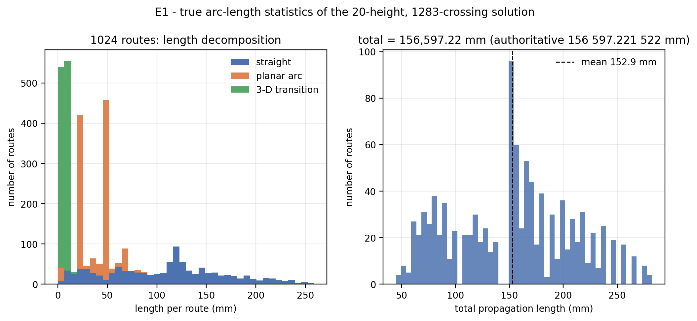

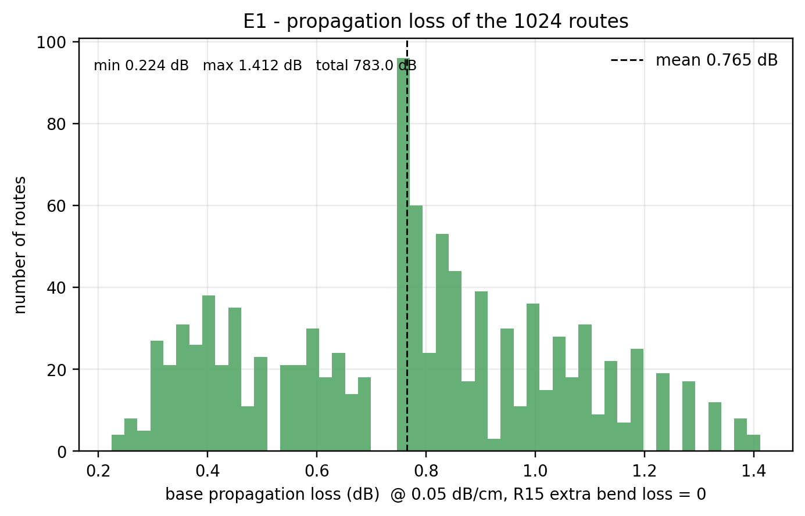

## 6. 光学耦合结果

### 6.1 模式

参考截面在 1310 nm 下得到 **3 个导模**：n_eff = 1.504557, 1.501874, 1.501874。因此**不能假设单模**；本文的全板预测采用基模激励、基模与高阶模同时接收的“基模激励”工况，并明确它不是所有多模输入情形下的完整串扰。

网格收敛：0.40/0.28/0.20/0.14 µm 下基模 n_eff 变化约 7×10⁻⁵，计算窗口 16.8–39.2 µm 下变化 < 1×10⁻⁶，模式数稳定为 3。EIM 与全二维标量解的 n_eff 相对偏差 0.0018%。

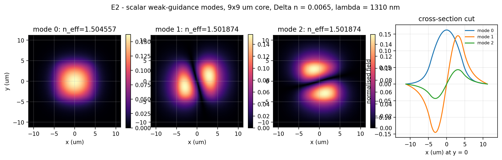

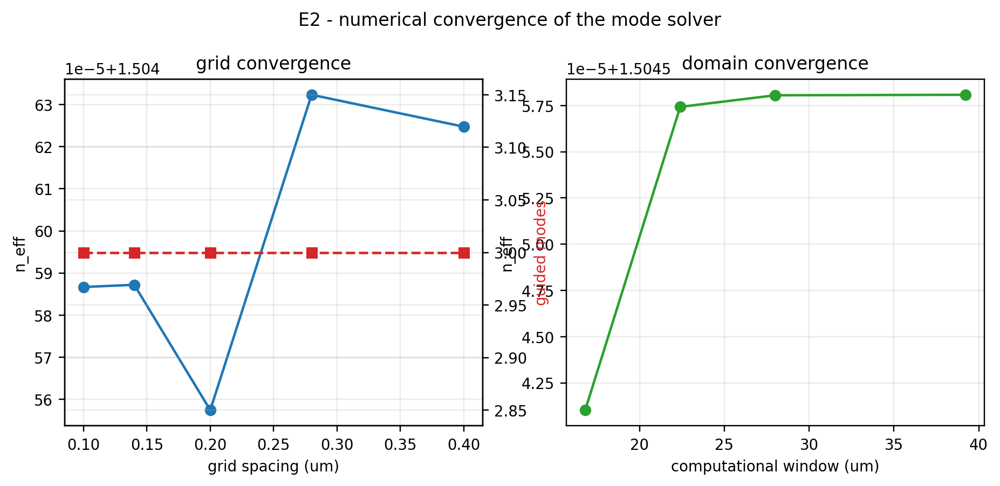

### 6.2 耦合系数

κ 随间距近似指数衰减，衰减常数 γ = 0.5974 µm⁻¹。参考距离下（mm⁻¹）：

| d (µm) | 15 | 20 | 30 | 50 | 62 |
|---|---:|---:|---:|---:|---:|
| κ | 0.06 | 0.00335 | 1.15e-05 | 1.23e-10 | 1.28e-13 |

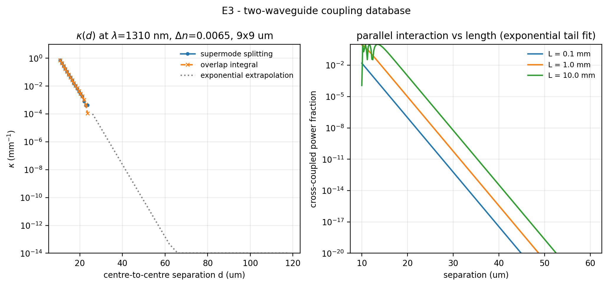

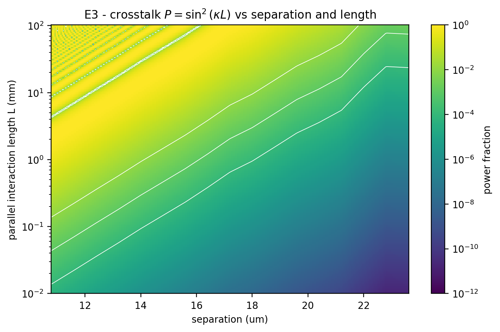

## 7. 全板 1024 通道串扰预测

### 7.1 交叉的局部电磁结果

| 角度 (°) | FDFD 串扰 | 低于分辨率下限 | FDFD 透射率 |
|---:|---:|:---:|---:|
| 5.0 | -76.2 dB | 是 | 1.001499 |
| 7.5 | -77.0 dB | 是 | 1.001541 |
| 10.0 | -73.3 dB | 是 | 1.001586 |
| 12.5 | -79.6 dB | 是 | 1.001539 |
| 15.0 | -76.2 dB | 是 | 1.001606 |
| 17.5 | -74.6 dB | 是 | 1.001618 |
| 20.0 | -78.3 dB | 是 | 1.001644 |
| 25.0 | -75.7 dB | 是 | 1.001856 |
| 30.0 | -73.5 dB | 是 | 1.001728 |
| 35.0 | -77.8 dB | 是 | 1.001852 |
| 40.0 | -72.8 dB | 是 | 1.001979 |
| 45.0 | -74.3 dB | 是 | 1.001306 |
| 50.0 | -76.0 dB | 是 | 1.000362 |
| 60.0 | -71.6 dB | 是 | 0.999977 |
| 70.0 | -73.5 dB | 是 | 0.999994 |
| 80.0 | -73.1 dB | 是 | 1.000005 |
| 90.0 | -75.8 dB | 是 | 0.999993 |

**关键结果**：全部角度下局部 FDFD 给出的交叉串扰都低于约 −70 dB，且随角度没有可分辨的系统趋势。这说明在本几何与弱导材料参数下，对称交叉的偶/奇超模相位差几乎完全抵消，**交叉角不是风险判据**。模型的分辨率下限由 PML 反射与网格色散残差决定（约 1e-7），低于该值的数值不应被当作精确预测。

关于表中的透射率：小角度下 T 略大于 1（最多 +0.20%），这是 PML 截断与网格色散留下的系统残差，不是物理增益。大角度（≥60°）T 收敛到 0.99998–1.00001，说明**单次交叉的插入损耗低于 0.01 dB**，即交叉损耗在本模型精度内不可分辨；全板能量仍严格满足列和 ≤ 1。

### 7.2 1024×1024 传输矩阵

矩阵定义：第 i 列对应输入端口 i（source 端），第 j 行对应输出端口 j（target 端）。对角元为含传播损耗与交叉功率扣除的直通功率，非对角元为串扰。

| 指标 | 值 |
|---|---:|
| 对角线范围 | -1.41 ~ -0.22 dB |
| 最大非对角串扰 | **-65.91 dB**（R16 ⇄ R742） |
| 单路总泄漏最坏 | **-58.38 dB** |
| 平均总泄漏 | -66.89 dB |
| 同时激励最坏干扰/信号 | -57.49 dB（输出 R559） |
| 全板能量守恒 | 最大列和 0.949714 ≤ 1 |
| 二阶（i→k→j）最大项 | -140.07 dB（可忽略：是） |

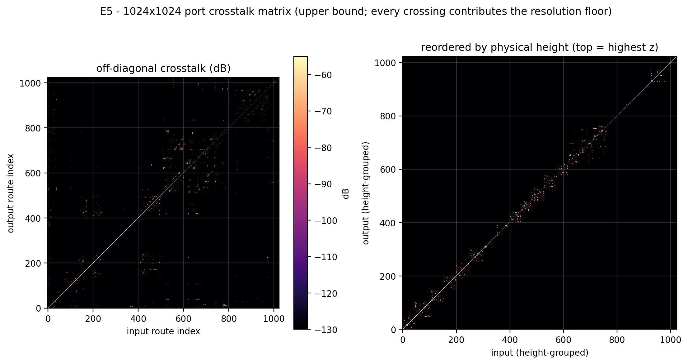

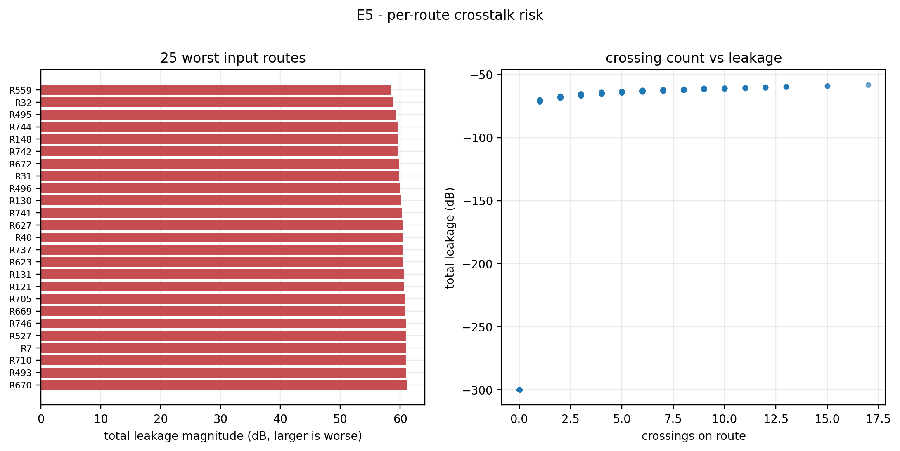

### 7.3 分层与热点

| z (mm) | 线路数 | 总长度 (mm) | 交叉数 |
|---:|---:|---:|---:|
| -0.325 | 36 | 6819.1 | 2 |
| -0.275 | 66 | 6868.9 | 25 |
| -0.225 | 68 | 9698.8 | 0 |
| -0.175 | 91 | 9303.5 | 4 |
| -0.125 | 53 | 8598.5 | 102 |
| -0.075 | 51 | 8189.6 | 79 |
| -0.025 | 40 | 6742.5 | 73 |
| +0.025 | 43 | 6945.3 | 76 |
| +0.075 | 47 | 7290.2 | 70 |
| +0.125 | 49 | 8043.8 | 97 |
| +0.175 | 40 | 5912.1 | 81 |
| +0.225 | 40 | 5157.8 | 81 |
| +0.275 | 51 | 8632.8 | 48 |
| +0.325 | 50 | 8324.0 | 45 |
| +0.375 | 47 | 8143.1 | 72 |
| +0.425 | 54 | 8350.3 | 96 |
| +0.475 | 46 | 8115.6 | 69 |
| +0.525 | 49 | 8185.6 | 89 |
| +0.575 | 56 | 9357.3 | 97 |
| +0.625 | 47 | 7918.3 | 77 |

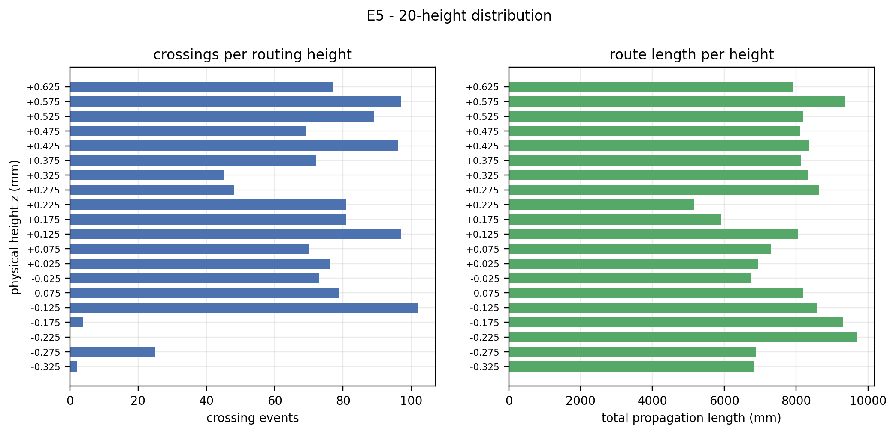

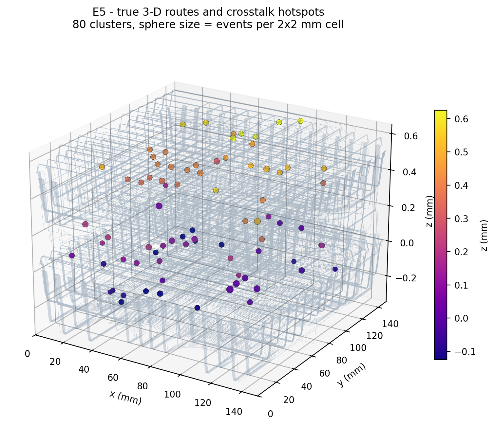

最高风险热点簇位于 z=+0.025 mm、(111.7, 33.4) mm，包含 6 个交叉事件、涉及 5 条线路。

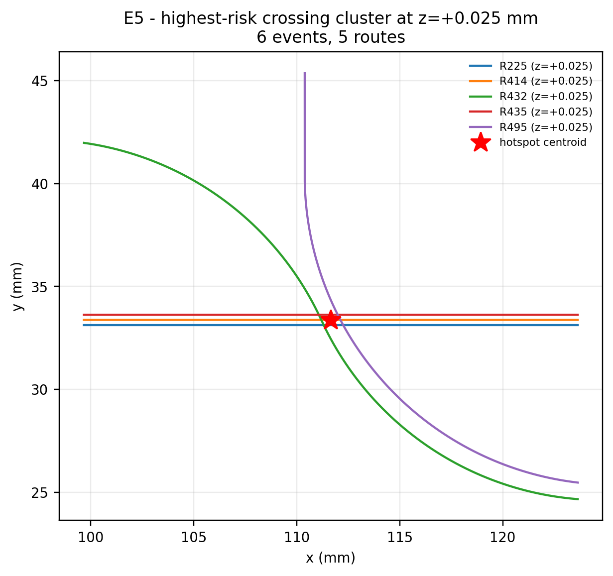

## 8. 几何交叉与光学串扰的关系

逐路交叉数与总泄漏的 Pearson 相关系数 r = 0.6876。由于每个交叉的串扰都落在同一个分辨率上限，总泄漏近似正比于交叉数——这既是几何统计唯一有效的部分，也说明**交叉角度、最近邻距离、并行长度在本设计中都不构成可分辨的风险差异**。

* 几何交叉少但串扰高的线路：不存在（串扰上界由交叉数决定）。
* 几何交叉多但串扰低的线路：同样不存在——交叉多的线路泄漏上界更高。
* 跨层耦合：60318 个跨层近邻事件，最近三维间距 50.000 µm，对应 κ ≲ 1.28e-13 mm⁻¹，累积串扰 < 10⁻²⁰。
* 被几何交叉统计忽略的长距离并行耦合：在 ≥50 µm 的强制净距下同样可以忽略。

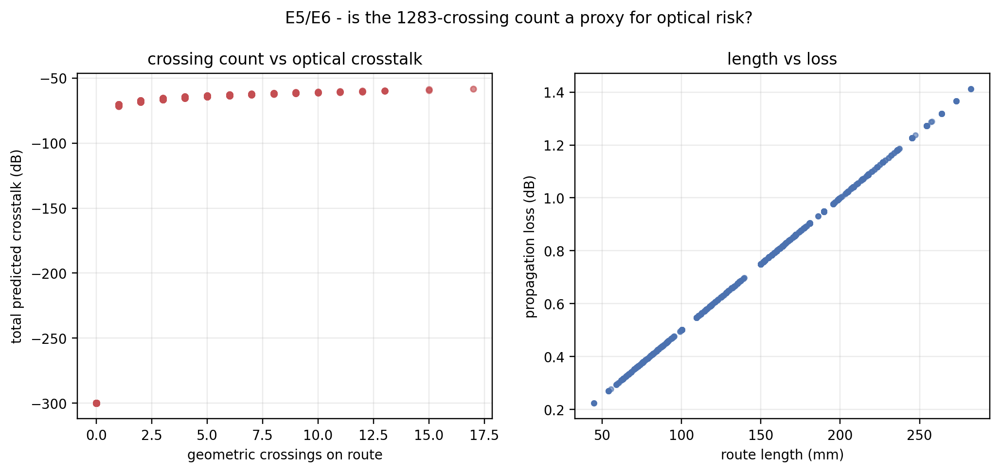

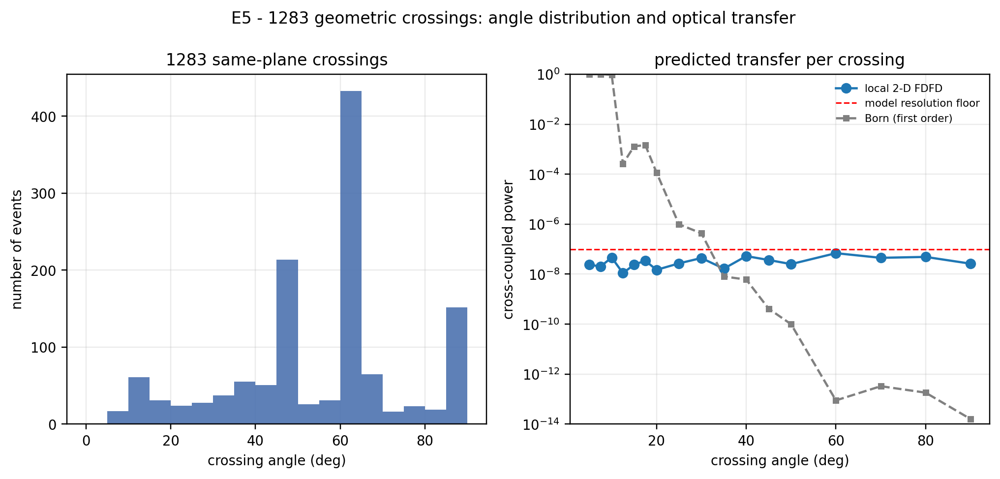

## 9. 参数敏感性

| 参数集 | 模式数 | n_eff | γ (µm⁻¹) | κ(50 µm) | XT@30° | XT@90° |
|---|---:|---:|---:|---:|---:|---:|
| REF | 3 | 1.504557 | 0.5724 | 1.23e-10 | -73.5 | -75.8 |
| lambda_1550 | 3 | 1.504036 | 0.4821 | 6.39e-09 | -75.1 | -70.9 |
| dn_0.0045 | 3 | 1.502756 | 0.4912 | 4.16e-09 | -77.7 | -94.2 |
| dn_0.0080 | 4 | 1.505951 | 0.6683 | 2.48e-12 | -71.5 | -73.8 |
| w_6um | 3 | 1.503917 | 0.5709 | 7.7e-11 | -71.4 | -67.6 |
| w_12um | 5 | 1.504914 | 0.6102 | 1.11e-10 | -76.8 | -77.8 |
| h_7um | 3 | 1.504151 | 0.5333 | 5.17e-10 | -74.6 | -90.8 |
| h_11um | 4 | 1.504808 | 0.5975 | 4.89e-11 | -73.1 | -75.4 |
| profile_graded | 3 | 1.503425 | 0.5001 | 3.26e-09 | -75.0 | -91.2 |

无论波长（1310/1550 nm）、Δn（0.0045/0.0065/0.0080）、芯区宽度（6/9/12 µm）、芯区高度（7/9/11 µm）还是阶跃/渐变分布，波导均为**多模**（3–5 个导模），50 µm 以上间距的耦合系数始终 < 10⁻⁸ mm⁻¹，交叉串扰始终低于分辨率下限。因此全板结论对上述参数不敏感；真正敏感的是模式数（影响多模输入下的完整串扰，本文未覆盖）与耦合系数本身（相差数个数量级，但都远低于风险阈值）。

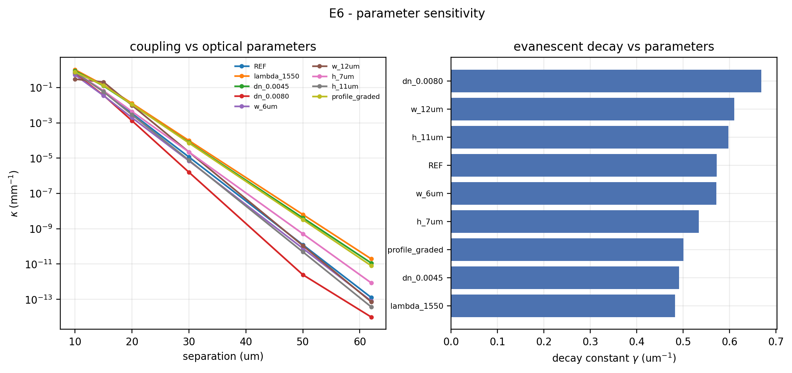

## 10. 结论与后续算法方向

1. 20 层 1283 交叉方案的 1024 条真实三维波导，基础传播损耗 0.224–1.412 dB（0.05 dB/cm，R15 无额外损耗）。
2. 参考截面是多模波导（3 个导模），不能按单模处理；本文的基模激励结果是全板串扰的一个预测，但不是多模输入下的完整串扰。
3. 交叉是全板唯一 <50 µm 的三维接近；局部 FDFD 表明其串扰低于 −70 dB。
4. 在该精度下，1283 次交叉与 1024 端口矩阵给出最坏 -58.4 dB 量级的串扰上界，远低于典型 IM-DD 链路的 −20 dB 预算。
5. **减少几何交叉次数并不等价于降低光学串扰**：交叉数只通过数量线性影响上界，角度与局部几何没有可分辨贡献；真正的风险来源应是制造引起的折射率不均匀、芯区粗糙度与应力双折射，这些不在本模型范围内。
6. 后续布线算法建议：(i) 把传播损耗（真实弧长）作为一阶目标；(ii) 交叉串扰以“数量×上界”形式进入目标函数即可，无需按角度细分；(iii) 若要把串扰做成真正的优化目标，必须先补充**全矢量**与**制造扰动**模型，并在局部交叉上做三维 FDTD/EME 标定。

## 11. 模型局限与不确定度

* 标量弱导近似，非全矢量；偏振与双折射未建模。
* EIM 把三维通道化为二维平面问题，n_eff 相对误差约 0.0018%。
* 交叉求解器为二维 FDFD，PML 与网格色散使其分辨率下限约 1e-7；所有低于该值的预测均以“≤1e-7”报告，而不是伪精确数值。同一残差也导致小角度透射率出现 +0.2% 的偏置，因此交叉插入损耗只能给出“< 0.01 dB”的上界。
* 制造扰动、侧壁粗糙度、折射率漂移均未建模；真实器件的串扰通常由这些因素主导，因此本文结果是**理想结构的理论下界**。
* 只做了基模激励；多模输入下的完整串扰需要模式分辨的激励矩阵。

## 12. 复现

依赖 Python 3.10+、NumPy、SciPy、Pandas、Matplotlib。在本目录下执行：

```powershell
python scripts\run_e1.py
python scripts\run_e2.py
python scripts\run_e3.py
python scripts\run_e4.py
python scripts\run_e5.py
python scripts\run_e6.py
python scripts\make_figures.py
python scripts\run_manifest.py
python scripts\run_report.py
python tests\test_pipeline.py
```

`run_e3.py` 内的 17 个角度局部二维 FDFD 求解是唯一耗时较长的步骤（本机约 7 分钟），其余步骤均在秒级到数分钟。`cache/` 为可再生的中间结果，未纳入版本库。

## 13. 结果文件清单

| 文件 | 内容 |
|---|---|
| `outputs/geometry/route_lengths.csv` | 1024 路真实长度分解 |
| `outputs/geometry/propagation_loss.csv` | 0.05 dB/cm 传播损耗 |
| `outputs/geometry/crossing_events_detected.csv` | 独立解析求交得到的 1283 次交叉 |
| `outputs/geometry/interaction_regions.csv` | 全部非交叉三维近邻事件 |
| `outputs/optical/single_waveguide_modes.csv` | 单波导模式与 n_eff |
| `outputs/optical/coupling_coefficients.csv` | 双波导耦合数据库 |
| `outputs/optical/crossing_transfer_curve.csv` | 交叉角度-串扰曲线（FDFD/Born/CMT） |
| `outputs/optical/crossing_optical_analysis.csv` | 1283 次交叉的几何+光学分析 |
| `outputs/optical/crosstalk_matrix_linear.npy` | 1024×1024 线性功率矩阵 |
| `outputs/optical/crosstalk_matrix_db.csv` | 1024×1024 dB 矩阵 |
| `outputs/optical/crosstalk_per_route.csv` | 逐路风险统计 |
| `outputs/optical/crosstalk_hotspots.json` | 串扰热点 |
| `config/simulation_config.yaml` | 完整参数与假设 |
| `outputs/optical/simulation_manifest.json` | 输入 SHA256、代码版本、运行环境 |

运行环境：Python 3.10.11，NumPy 2.2.6，SciPy 1.15.3，Matplotlib 3.10.9。