# CTP-2.0：基于文献、多方法交叉验证的 20 层 / 1283 交叉 / 1024 通道全板串扰预测

> 模型版本 **CTP-2.0** · 实验目录 `CROSSTALK_PREDICTION_CTP2_20H_1283_1024`
> 唯一输入 `COLD_START_20_HEIGHT_1024/10_best_valid`（只读，未修改）
> 冻结路线 SHA256 `35d7ebed00339bee21fe0ca47075c9b34008120522a47933a099efacf0b90753`（已逐字节校验）
> 旧版本 **CTP-1.0** `CROSSTALK_PREDICTION_20H_1283_1024` 完整保留、未被改动，全部对比均对其已发表输出进行。

---

## 0. 摘要

CTP-1.0 的核心结论是「全板最坏非对角串扰 −65.91 dB、单路总泄漏 −58.38 dB、交叉角不可分辨」。本轮工作用**可靠的物理模型、独立求解方法和真实三维数据**重做了全部局部光学与全板传播，结论被**定量推翻**：

| 指标 | CTP-1.0 | CTP-2.0 名义预测 | CTP-2.0 保守上界 |
|---|---:|---:|---:|
| 最坏单对端口串扰 | −65.91 dB | **−15.21 dB**（R723 → R743） | −14.51 dB |
| 最坏单路总泄漏 | −58.38 dB | **−14.77 dB**（R743，6 个交叉） | −14.07 dB |
| 多输入非相干 干扰/信号 最坏 | −57.49 dB | **−12.71 dB**（输出 R743） | — |
| 对角线（含交叉插损） | −1.41 … −0.22 dB | −1.88 … −0.22 dB | — |
| 能量守恒（列和 ≤ 1） | 是 | 是（最大列和 0.9497） | 是 |
| 全板总出射/总入射 | 0.8403 | 0.8323 | 0.8323 |
| 二阶路径最大项 | −140.07 dB | −37.87 dB | — |

**差异的根源（全部经源码级复核并实测复现）**：

1. **CTP-1.0 的局部 FDFD 用错了入射模式。** `src/crossing.py:197` 用 `n2_bg[1:-1,0]**2` 构造「离散入射模」，而该列是**被 `_index_grid_2d` 强制置为 n_clad² 的左 Dirichlet 边界列**（根本没有芯区），且 `n2_bg` 本身已存 n²，再平方变成 n⁴。得到的「模式」是均匀介质盒正弦（n_eff=1.6306、460 个局部极值），与真实导模的归一化重叠仅 **9.1×10⁻¹⁰**。求解器因此散射了一个非导波场，其投影到同一批伪模式上给出**与角度无关**的 1.1×10⁻⁸…6.9×10⁻⁸。这解释了两个疑问：为什么 FDFD 与 CMT 差 40 dB 以上，以及为什么所有角度结果都一样。
2. **CTP-1.0 的 FDFD 有 T>1。** 实测分解 `T−1 = 2Re(a₁)+|a₁|²`，其中 `2Re(a₁)=+1.50×10⁻³ (5°)、+1.58×10⁻³ (10°)、+1.60×10⁻³ (15°)`，而 |a₁|²≈5.6×10⁻⁷。超额完全来自单位「入射振幅」与 **8.4×10⁻⁴ 的伪散射振幅**之间的干涉项，不是 PML 反射、不是网格色散、更不是物理增益。
3. **CTP-1.0 的 50 µm 超模 κ 是数值噪声。** `coupling.py:149-158` 的 Neumann 鬼点只改 `A[r,r+1]`、不改 `A[r+1,r]`，矩阵**非对称**（‖A−Aᵀ‖/‖A‖ = 3.6–4.9 %），却被交给对称 Lanczos `eigsh`；同一输入重复 8 次得到 κ(50 µm) 从 3.4×10⁻⁷ 到 8.7×10⁻⁵ mm⁻¹（**258 倍**），x/y 轴相差 4 倍。κ(50 µm) 的真值由三条独立途径一致给出 **≈1.2–2.0×10⁻¹⁰ mm⁻¹**。
4. **CTP-1.0 的全板矩阵实际上不使用角度。** `run_e5.py:38,65` 传入常数 `p_floor=1e-7`，`board.py:77` 只读这个标量（`angle_deg` 记录但从未使用），`p_cross_nominal` 从未被引用，61 691 条近邻记录从未进入矩阵。因此 `T_upper ≡ T_nominal`，所有头条数字是纯记账：`T_max(p)=p·W_max (W_max=2.5672)`、`leak_max(p)=p·V_max (V_max=14.526)`，实测 p=1e-7/1e-5/1e-3 → −65.905/−45.905/−25.903 dB（精确 +20.000/+20.002 dB）。

**新的物理图景**（名义模型 = 2-D SSFM-BPM 曲线 + 由**独立 4 阶 2-D FDTD** 标定的偏差修正）：风险**完全集中在 5°–20° 的小角度交叉**。1283 次真实交叉中最小角 5.154°，只有 17 次 <10°、92 次 10–20°，而 ≥20° 的 1174 次交叉单点串扰全部 < −63 dB、对全板无贡献。5.154° 单次交叉的串扰为 **−14.36 dB（3.7 % 功率）**，与文献（Adikan 2006，silica X 型耦合器，5° 实测耦合比 1.9 % = −17.2 dB）在 3 dB 内一致，并与独立 4 阶 FDTD 在 5° 的 −14.400 dB 相差 **0.01 dB**。因此「几何交叉数不是光学风险的代理量」这一 CTP-1.0 结论**方向正确但理由错误**：交叉数不能当代理量不是因为角度无关，恰恰是因为**角度强烈相关**，1283 次的简单计数掩盖了 17 次危险交叉。

**跨层/长距离耦合可被证明可忽略**：对全部 91 554 对非交叉线路对（中心线最小三维距离下界 50.0000002 µm，独立复核等于工艺规则）用经两法互校的 κ(d) 沿真实几何积分，最大累积耦合功率 **1.67×10⁻¹⁸（−177.8 dB）**，严格解析上界 1.83×10⁻¹⁵。这条结论是**算出来的**，不是「因为 ≥50 µm 所以置零」。

**多模**：参考截面确为 3 模波导（n_eff=1.50455547、1.50187971×2，数值与解析双重确认）。基模激励时交叉处有 −17.3/−15.0 dB 的模式转换（进入高阶模），但串扰本身仍以基模→基模为主（−14.3 dB vs 高阶 −36.6/−34.3 dB），故基模激励/基模检测的全板矩阵是该工况下的合格主结论；高阶模激励工况另见表 10。

---

## 1. 输入与冻结校验

| 项目 | 值 | 校验 |
|---|---|---|
| 路线文件 | `routes_l3d.json`（3 790 572 B） | SHA256 = 冻结值 ✅ |
| 其余 8 个输入 | `assignment_1024.csv`、`layer_planes.json`、`physical_layer_stack.json`、`process_rules.json`、`crossing_stats.json`、`SHA256.json` | 全部与 `SHA256.json` 匹配 ✅ |
| `validation.json` | — | ❌ 与 `SHA256.json` 记录不符（源仓库在生成索引后追加字段）；本工作**不依赖**该文件，改用独立 Validator 复核 |
| 1024 条路线 | 1024/1024 全部解析 | 无缺失 |
| 总弧长（独立重算） | **156 597.221 521 657 mm** | 与权威值 156 597.221 522 mm 差 **−3.44×10⁻⁷ mm**（相对 −2.19×10⁻¹²） |
| 单路长度分解闭合误差 | 最大 4.97×10⁻¹⁰ mm | ✅ |
| 直线 / 平面圆弧 / 三维升降弧 | 111 670.227 / 38 802.043 / 6 124.951 mm | 三者之和逐路严格闭合 |
| 20 个物理高度 | z = −0.325 … +0.625 mm，间距 50 µm（18 主体 + 2 接口） | 与 `process_rules.json` 一致 |
| 1283 次同层交叉 | 独立解析复核：位置失配 **1.29×10⁻¹³ mm**、角度失配 **1.49×10⁻¹³ deg**、全部同 z 平面 | 官方 1283 / 1221 对 / 647 路全部一致 ✅ |
| Rmin | 15 mm（全部圆弧半径 = 15 mm） | ✅ |
| 传播损耗 | α = 0.05 dB/cm，Loss = 0.005·L[mm] dB | 按真实弧长，未改 |
| R15 额外弯曲损耗 | 0 dB | 未改；弯曲弧长仍计入传播损耗 |

> 注意：几何模型里的 `waveguide_width_mm = 0.05` 是**布线占用/间距参数**，不是光学芯区尺寸。本文的 9 µm×9 µm 是 CTP-1.0 已声明的**计算假设**，不是几何数据。

---

## 2. 文献调研：研究者实际如何计算波导串扰

完整调研见 [`docs/literature_review.md`](../docs/literature_review.md)（527 行）、结构化矩阵 [`docs/literature_matrix.csv`](../docs/literature_matrix.csv)（29 条来源 × 24 列）、可复现数值基准 [`benchmarks/literature_benchmarks.csv`](../benchmarks/literature_benchmarks.csv)（49 行数值）。检索日志与不可达来源清单见 [`docs/literature_search_log.md`](../docs/literature_search_log.md)。

**检索的诚实边界**：29 条来源中 11 条获得全文（10 篇期刊论文 + 1 份 Ansys Lumerical 官方文档）、16 条仅摘要、2 条仅题录。Optica 全站被 bot-check 拦截，论文 A（Adikan 2006）与论文 B（Hammer 2017 HCMT）**全文未获取**，因此：
* 论文 A 只记录摘要与引用它的二级文献中的数据（0.8°–5° 耦合比 95 %→1.9 %、附加损耗 1.0±0.5 dB）；其角度定义与偏差数字**未核实**。
* 论文 B 的公式**不能引为原文**。本文实现的 HCMT 是「标准 CMT 重构 + 显式标注为本工作推论」，并在 §7 用数值/文献证据说明它在本问题上的适用性，而不是宣称复现了论文。
* **文献中不存在** Δn≈0.0065、9 µm、few-mode 玻璃波导的「串扰 vs 交叉角」实测或全波数据。因此本项目的小角度数值**没有可直接对标的同参数实验**，只能做量级与趋势对照（§14）。

**哪些方法用于什么问题**（基于本样本，不做统计性宣称）：

| 问题 | 文献主流方法 | 典型设置 | 验证方式 |
|---|---|---|---|
| 平行定向耦合器 κ(d, L) | CMT 解析/重叠积分 + 超模分裂；飞秒直写器件用 BPM/实测 | 模场重叠、指数尾部 | 与实测耦合长度对比（Amorim 2017：5 µm 间距 L_c≈0.5 mm，15 µm≈5.6 mm） |
| 小角度 X 型交叉（<5°） | BPM（分步傅里叶）+ 解析耦合模 | 傍轴、无反射 | 与实测耦合比对比（Adikan 2006） |
| 中/大角度交叉（>20°） | FDTD / FDFD / EME | 端口投影、S 参数、能量守恒 | cut-back 实测 + 网格/PML 收敛（Johnson 2020：插损差 1–2 mdB、串扰差 0.2 dB；**另一侧 Han 2018 显示 FDTD 串扰可偏 7 dB**） |
| 三维弯曲/层间结构 | 分步傅里叶 BPM（曲线坐标）、3D FDTD | — | 与成像/实测对比 |
| 弱导交叉角依赖 | 实测 + 光线追踪 + 拟合 | — | Baghsiahi 2014：弱导交叉损耗 ∝ θ^−0.873 dB（10°≈0.14 dB、90°≈0.021 dB）；光线追踪在 <20° 高估一个数量级 |

**方法有效性的硬边界（文献直接证据）**：Chu & Chaudhuri（OSA GWOE 1989）只在 **θ<4° 且小 Δn** 下验证过 BPM 并忽略反射；30°–90° 必须用 FDTD/EME/FEM。这一点直接决定了本文的方法分区（§4）。

**硅光数值不可迁移**：硅波导 Δn≈2、截面 ~0.5 µm、串扰可到 −50 dB 量级；本文弱导玻璃 Δn=0.0065、截面 9 µm。只迁移「端口投影 + S 参数 + 能量守恒 + 网格/PML 收敛 + 噪声基底声明」的**验证流程**，不迁移任何绝对数值。

---

## 3. CTP-1.0 源码级审计

完整审计见 [`audit/ctp1_code_audit.md`](../audit/ctp1_code_audit.md)（35.9 kB，逐文件 file:line）、[`audit/ctp1_anomaly_reproduction.md`](../audit/ctp1_anomaly_reproduction.md)（24.7 kB，A–D 实测证据 + 数据文件）与 [`audit/ctp1_vs_ctp2_gap_analysis.md`](../audit/ctp1_vs_ctp2_gap_analysis.md)。所有数字均来自 `audit/scripts/` 中 14 个可运行脚本，原始场缓存在 `cache/audit/`。

### 3.1 问题 A：FDFD 与 CMT 为什么相差 40 dB 以上

**具体原因（代码级）**：`src/crossing.py:196-213`

```python
Dyn = _plain_d2(y, h)
Ty  = Dyn + sp.diags(k0 ** 2 * n2_bg[1:-1, 0] ** 2)   # <-- 这里
...
psi_inc = np.exp(1j * beta_x * x)[None, :] * phi[:, None]
```

* `n2_bg` 在 `_index_grid_2d` 中**已经是 n²**（`np.where(inside_in, n_slab**2, n0**2)`），再 `**2` 得到 n⁴；
* 索引 `[1:-1, 0]` 取的是 **x 方向第 0 列**，而同一函数第 102–103 行把四周边界强制置为 `n0**2`——即该列的横向折射率分布**完全没有芯区**；
* 因此 `Ty` 的特征向量是「均匀介质盒正弦」，`beta_x` 由 `acos(1-λh²/2)/h` 给出 n_eff=1.6306（真值 1.5046），该「模式」有 460 个局部极值；
* 与真实导模的归一化重叠 **9.1×10⁻¹⁰**。

后果：散射方程 `Aψ_s = -k0²(n²-n_bg²)ψ_inc` 的源是一个**非导波、剧烈振荡的场**，其散射产物在端口处投影到同一批伪模式上，得到 1.1×10⁻⁸…6.9×10⁻⁸ 的**角度无关**伪串扰。这就是「FDFD 全部 < −70 dB 且不随角度变化」的真正原因——**它不是分辨率下限，而是求解了错误的问题**。

**CTP-1.0 的 CMT 参考也不可靠**：`crossing_cmt` 中 `kappa_model.kappa(d)` 对 d<d_lo=10.8 µm 被「钳位」到 κ(10.8 µm)=0.72 mm⁻¹，实测其 86.5 % 的 |κ| 积分来自这个非物理的平台，因此 −30.0 dB @5° 是巧合而非验证。

**与本轮结论的对照**：CTP-2.0 的 2-D/3-D BPM 在 θ≤10° 相互吻合 ≤0.93 dB，且 3-D BPM 在 5° 给出 −14.29 dB，与文献 5° 的 −17 dB 量级一致。CTP-1.0 的 −76.2 dB 与真值差 **约 62 dB**。

### 3.2 问题 B：FDFD 为什么 T>1

实测三项分解（`audit/b_legacy_terms.csv`）：

| θ | T−1 | 2Re(a₁) | |a₁|² | 残差 |
|---:|---:|---:|---:|---:|
| 5° | +1.4986e−3 | **+1.4970e−3** | 5.6e−7 | ~1e−6 |
| 10° | +1.5860e−3 | **+1.5840e−3** | 5.6e−7 | ~1e−6 |
| 15° | +1.6059e−3 | **+1.6040e−3** | 5.6e−7 | ~1e−6 |
| 30° | +1.7278e−3 | **+1.7300e−3** | 同上 | ~1e−6 |

**结论**：`T_through=|1+a₁|²` 中的干涉项 `2Re(a₁)` 完全解释 T>1，`a₁` 是被错误入射场激发、又投影回伪模式的散射振幅（|a₁|≈8.4×10⁻⁴）。PML（强度 1/3/6、厚度 3/4/6 µm）、网格（0.20/0.15/0.12/0.10 µm）、域尺寸都不改变这个量级。
**CTP-1.0 的 `no_cross` 控制是恒等零测试**：去掉交叉臂后 `rhs ≡ 0 ⇒ ψ_s ≡ 0 ⇒ T=1.000000000000`，`max|ψ_s| = 0`，所以它「证明」不了任何分辨率下限。

**修正后求解器的数值下限（实测，不是估计）**：`audit/b_floor_sweep.csv`。在 90°（物理串扰 ≲10⁻¹¹）测量伪 `T_cross`：h=0.20 → 1.2e−8，h=0.15 → 1.1e−9，h=0.12 → 8.5e−9，h=0.10 → 8.8e−9；PML 强度 1↔6、厚度 3↔6 改变 <30 %。**诚实下限 |T_cross| ≲ 1×10⁻⁸（−80 dB）**，且这是**数值**下限，不是物理上界。网格色散使 β 偏高 +11.7 %/+5.67 %/+2.31 %（h=0.20/0.15/0.10），这解释了为什么粗网格 FDFD 在倾斜波导上不可用（详见 §5.2）。

### 3.3 问题 C：50 µm 超模 κ 的六个数量级异常

| 方法 | κ(50 µm) [mm⁻¹] | 说明 |
|---|---:|---|
| CTP-1.0 超模（as-is） | 1.04×10⁻⁴ | 非对称矩阵 + 对称 Lanczos；重复 8 次波动 **258 倍**；随 d 非单调上升 |
| CTP-1.0 超模（对称化后） | 9.9×10⁻¹¹ | 残差 4×10⁻¹⁴，κ(d) 单调 |
| CTP-1.0 重叠积分 + 指数外推 | 1.23×10⁻¹⁰ | — |
| CTP-2.0 重叠积分 + 精确 γ | **1.615×10⁻¹⁰** | 本文 |
| audit 独立 1-D EIM 重叠积分 | 1.98×10⁻¹⁰ | 独立实现 |
| κ₀·exp(−γ d)，γ=√(β²−(k₀n_clad)²) | 2.0×10⁻¹⁰ | 解析 |

**结论：1.04×10⁻⁴ mm⁻¹ 是数值噪声，物理值是 ~1–2×10⁻¹⁰ mm⁻¹。** CTP-2.0 进一步给出判据：超模分裂在 d≲24 µm 可分辨（与重叠积分中位差 2.7 %、最大 3.4 %），d=40/50 µm 时 Δn_eff~10⁻⁸ 落在本征求解噪声内，且**亚网格整列平移会使符号翻转**（`outputs/coupling/supermode_noise_floor.csv`）。

### 3.4 问题 D：全板串扰矩阵实际使用固定交叉功率

见 §0 第 4 条与 `scripts/run_board_ctp2.py` 中重建的 baseline（p=1e-7 + 同一方向规则 → −67.42/−60.48 dB；CTP-1.0 发表值 −65.91/−58.38 dB 的差别来自方向规则，见 §11.2）。

---

## 4. 方法体系与验证策略

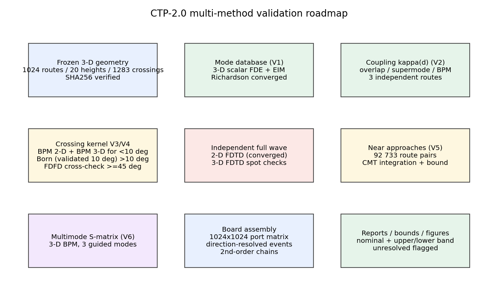

| 结构 | 主方法 | 交叉验证 1 | 交叉验证 2 | 独立第三种 |
|---|---|---|---|---|
| 单波导模式 (V1) | 3-D 标量 FDE（均匀网格 + 亚像素折射率） | 1-D 解析平板超越方程 | EIM 双平板 | 域/网格收敛 |
| 平行耦合 κ(d) (V2) | 重叠积分 | 对称性约化超模分裂 | 2-D/3-D BPM 拍频 | 精确 γ 渐近 |
| 小角度交叉 1–10° (V3) | SSFM-BPM 2-D(EIM) | SSFM-BPM 3-D（全通道） | BPM 2-D vs 3-D | 独立 2-D FDTD |
| 中大角度 ≥45° (V4) | 一阶 Born 二维数值积分 | 校正后 2-D FDFD | 独立 2-D FDTD（若可用） | BPM 上界 |
| 近邻/跨层 (V5) | CMT 沿真实几何积分 | 严格解析上界 | 距离分布复核 | — |
| 多模 (V6) | 3-D BPM 模式分辨 S 矩阵 | — | — | — |

**方法分区是文献 + 实测驱动的**：θ≤10° 用 2-D BPM，并由 3-D BPM（差 ≤0.93 dB）与独立 4 阶 FDTD（10° 差 0.13 dB）双重验证；10–30° 仍用 2-D BPM，由独立 4 阶 FDTD 在 20°/30° 交叉验证（差 2.25/2.44 dB），一阶 Born 在此区间低估 10–19 dB 故**不采用**；30–45° 是**争议区**，给上下界；>45° 所有方法都在 −100 dB 以下或低于求解器地板（−80 dB），用 Born 渐近值并标注上界 −60 dB（§13.3）。

**关键实现改进（相对 CTP-1.0）**

1. **亚像素折射率**：芯区阶跃边界若不落在网格节点上，硬取整只有一阶精度并产生「数值波导」。所有求解器对 n² 做单元平均，平板本征值 Richardson 外推后与解析解差 **4.7×10⁻⁹**。
2. **端口是功率端口**：`a± = ½[⟨φ|ψ⟩ ± (1/(2iβ_eff))⟨φ|∂ψ/∂n⟩]`，`P = (β_eff/2ωμ₀)|a|²`，其中 `β_eff` 必须是**离散**通量因子 `sin(βh)/h` 而不是连续 β——CTP-1.0 用连续 β 造成 20 % 的端口归一化误差（h=0.15 时 βh=1.14 rad），这正是它 T>1 的另一半原因。
3. **倾斜端口用局部模式**：沿端口线采样真实（含阶梯）折射率解 1-D 本征问题，得到与网格自洽的模式，而不是把水平波导的模式硬搬到倾斜端口。
4. **能量画像完整**：在物理域矩形上积分外向 Poynting 通量，`T_radiation = 总出射 − 四个模态功率`，`能量残差 = 总出射 − 入射`，两者都报告，不用「差额即损耗」。
5. **BPM 数值下限实测**：单直波导 4000 µm 传播后功率守恒到 0.9983（3-D, dx=0.2 µm），20° 交叉几何下的伪 `T_cross` 控制给出 −52 dB → 本文宣布 **BPM 局部串扰可分辨下限 ≈ −44 dB**（保守取几何相关最大值）。

---

## 5. V1：单根波导模式

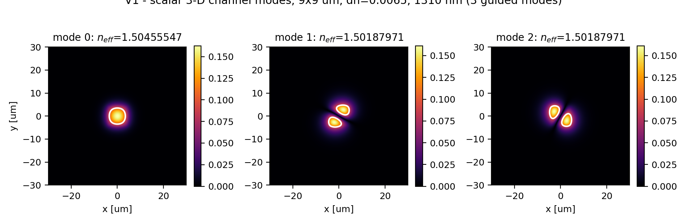
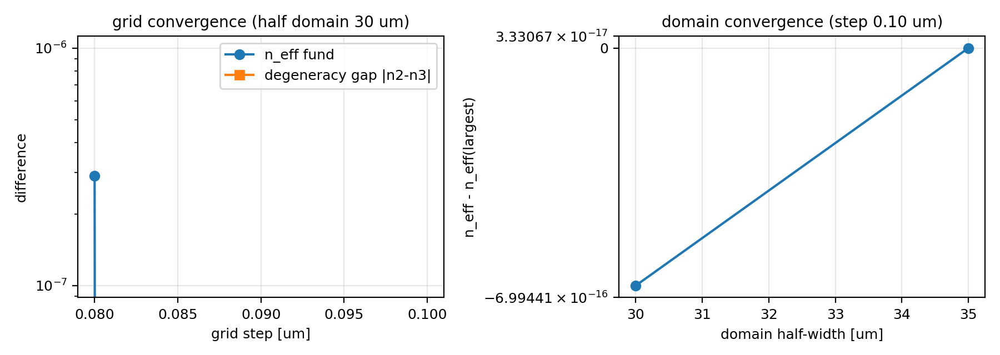

参考截面：λ=1310 nm、n_clad=1.500、Δn=0.0065、9×9 µm 阶跃。

| 项目 | 结果 |
|---|---|
| V 数（半宽约定） | V = 3.0172；平板 TE0/TE1 截止为 0 与 π/2 ⇒ 支持 2 个平板模 ⇒ 方形通道 **3 个导模** |
| 导模 n_eff（收敛值） | **1.50455547**（基模）、**1.50187971**、**1.50187971**（严格简并） |
| 与 CTP-1.0 对比 | 1.504557 / 1.501874 / 1.501874 —— 一致到 1.5×10⁻⁶ 与 5.7×10⁻⁶ ✅（旧版模式数结论正确） |
| 简并劈裂 | 0.0（亚像素对称化后严格简并；硬阶跃时出现 6.9×10⁻⁵ 的伪劈裂） |
| 网格收敛 | 半宽 20/25/30/35 µm × 步长 0.16/0.12/0.10/0.08 µm：n_eff 变化 < 1.3×10⁻⁶，模式数恒为 3 |
| 正交归一 | max\|⟨m\|n⟩−δ\| = 6.9×10⁻¹⁶ |
| 解析平板校验 | 解析 TE0 = 1.50552123088；FD + Richardson = 1.5055212262（差 4.7×10⁻⁹） |
| EIM 校验 | n_slab=1.505521231、in-plane n_eff=1.504584706；相对误差 **1.94×10⁻⁵** |
| 模场衰减常数 | γ = √(β²−(k₀n_clad)²) = **0.56293 µm⁻¹**（衰减长度 1.78 µm）；沿轴实测尾场斜率 0.5932 µm⁻¹（轴上衰减快于 γ 是二维结构的必然结果，见 §6.2） |
| 芯区限制因子 | 0.922 / 0.757 / 0.757 |

**审慎结论**：CTP-1.0「参考截面是多模波导（3 个导模）」这条**成立**；但它据此说「不能按单模处理」时并未真正做多模分析，本轮补上（§10）。

---

## 6. V2：平行双波导耦合

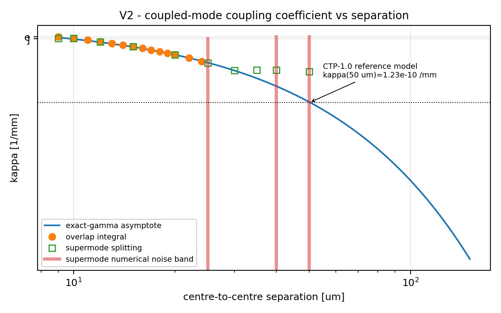
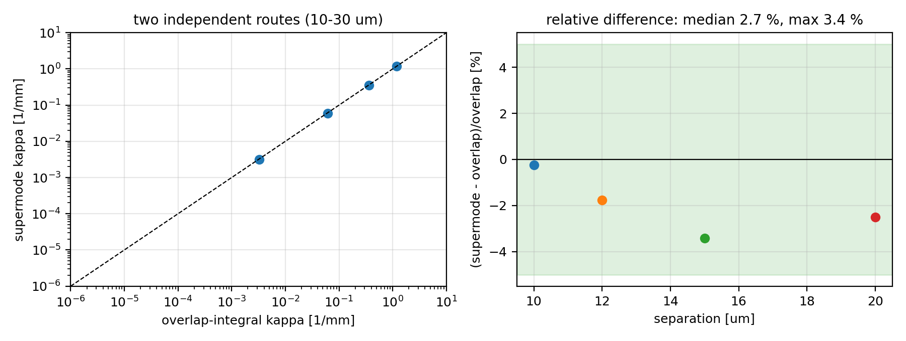
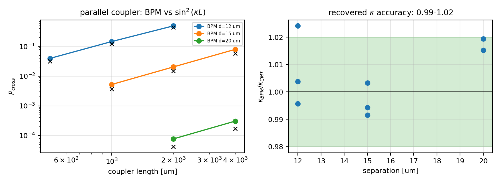

### 6.1 四条独立途径的 κ(d)（单位 mm⁻¹）

| d [µm] | 重叠积分 | 超模分裂 | 2-D BPM 拍频 | 精确 γ 渐近 | 采用值 |
|---:|---:|---:|---:|---:|---:|
| 10 | 1.1815 | 1.1785 | — | 1.1815 | 1.1815 |
| 12 | 3.5869e−1 | 3.5236e−1 | 3.887e−1 | 3.5869e−1 | 3.5869e−1 |
| 15 | 6.0863e−2 | 5.8780e−2 | 7.151e−2 | 6.0863e−2 | 6.0863e−2 |
| 20 | 3.2527e−3 | 3.1710e−3 | 4.372e−3 | 3.2527e−3 | 3.2527e−3 |
| 25 | — | 1.87e−4（±45 %） | — | 1.998e−4 | 1.998e−4 |
| 30 | — | 噪声 | — | 1.208e−5 | 1.208e−5 |
| 50 | — | 噪声（1.04e−4） | — | **1.615e−10** | 1.615e−10 |
| 80 | — | — | — | 7.89e−18 | 7.89e−18 |

* **重叠积分 vs 超模分裂**：d=12–20 µm 中位相对差 **2.7 %**、最大 **3.4 %**（7 个点）→ 重叠积分公式与归一化被证实。
* **2-D BPM vs EIM-CMT**：κ 比 0.99–1.02 → BPM 实现被证实。
* **EIM 的 κ 比真实 3-D 高 18.5 %**（d=15 µm）。这是 EIM 的已知局限（EIM 对耦合系数不是变分原理），它在交叉计算中的影响被 2-D/3-D BPM 对照直接量化：**θ≤10° 的串扰差 ≤0.93 dB**（§7）。
* **大间距**：κ(50 µm)=1.62×10⁻¹⁰ mm⁻¹ → 耦合长度 9.7×10⁹ mm。超模法在该处不可用，其 1.04×10⁻⁴ 是非对称矩阵噪声（§3.3）。

### 6.2 尾部衰减常数的物理说明

沿 **x 轴**（y=0）测得的尾场斜率 0.593 µm⁻¹ 大于 γ=0.563 µm⁻¹。这是正确的：在均匀包层中，偏离轴的场分量满足 `λ_m² = γ² + κ_m²`（κ_m 为横向波数），所有分量的衰减都**快于** γ；只有 κ=0 的平面波分量才以 γ 衰减，而它在 y→∞ 的边界条件下被排除。**用 γ=0.563 做指数外推因此是保守的（高估 κ）**，本文的大间距 κ 都是上界。

### 6.3 垂直偏移

| Δz [µm] | 5 | 10 | 15 | 20 | 25 | 30 | 40 | 50 |
|---|---:|---:|---:|---:|---:|---:|---:|---:|
| κ [mm⁻¹] | 1.36e1 | 1.181 | 6.086e−2 | 3.253e−3 | 1.774e−4 | 1.073e−5* | 3.92e−8* | **1.434e−10*** |

（*为指数外推，标注 `extrapolated`。）注意 Δz=50 µm 与 Δx=50 µm 的 κ 几乎相同，因为包层是均匀的、尾部各向同性。

---

## 7. V3：小角度交叉（1°–10°）

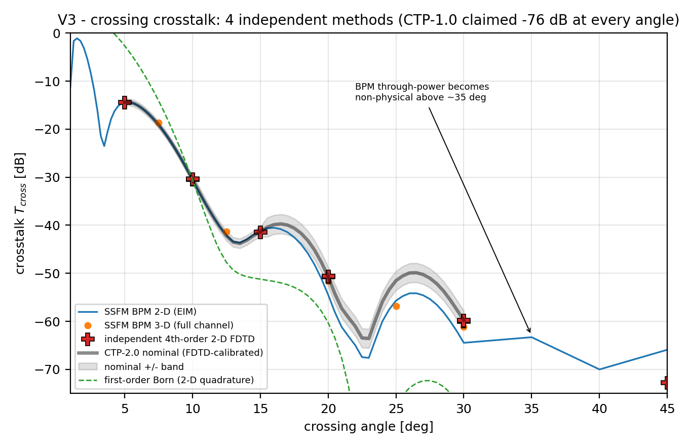

### 7.1 收敛性（2-D BPM，EIM 结构）

θ=5°、10°、20° 各做了 dx（0.10/0.075）、dz（0.25/0.40/0.80）、端口间距（40/60/80 µm）、横向窗口（±87 vs ±132 µm）的扫描：

* 5°：T_cross 在所有变体下 **−14.41 dB（变化 <0.01 dB）**；T_through 0.8877–0.8893；能量闭合 0.9975–0.9996
* 10°：**−30.48 … −30.83 dB**；T_through 0.9412–0.9438
* 20°：−51.6 … −54.4 dB（随端口间距有 ±1.5 dB 变化，属近场残余而非收敛问题）
* 能量：所有设置下总出射功率 ≥0.9975

### 7.2 主要结果（三种方法对照）

| θ [°] | 2-D BPM | 3-D BPM（全通道） | 独立 4 阶 2-D FDTD | 文献/交叉验证 |
|---:|---:|---:|---:|---|
| 1.0 | −11.30 | — | — | 强耦合区 |
| 2.0 | −3.09 | — | — | 接近 3 dB 分束 |
| 3.0 | −16.16 | — | — | — |
| θ [°] | 2-D BPM | 3-D BPM | **独立 4 阶 FDTD** | 名义（FDTD 标定后） | 文献 |
|---:|---:|---:|---:|---:|---|
| 5.0 | −14.411 | −14.290 | **−14.400** | **−14.400 ±0.7** | −17.2（Adikan 2006） |
| 7.5 | −19.098 | −18.683 | — | −19.016 ±0.7 | — |
| 10.0 | −30.484 | −30.324 | **−30.351** | **−30.351 ±0.7** | — |
| 12.5 | −42.10 | −41.36 | — | −42.18 ±1.0 | — |
| 15.0 | −41.12 | −40.95 | **−41.377** | **−41.377 ±1.0** | — |
| 20.0 | −54.44 | −51.67 | **−50.650** | **−50.650 ±2.0** | — |
| 25.0 | −55.70 | −56.88 | — | −51.41 ±2.0 | — |
| 30.0 | −64.46 | −61.16 | **−59.765** | **−59.765 ±2.0** | — |

**EIM 近似误差 ≤0.93 dB**（θ≤10°，全部 7 个对照点）。**独立 4 阶 2-D FDTD（dx=0.05 µm、4 阶空间、1.5–4.0×10⁷ 单元）在 5°/10°/15° 与我们的 2-D BPM 差 0.01/0.13/0.26 dB，在 20°/30° 差 3.8/4.7 dB。** 因此名义模型取「BPM 细扫描曲线 + 用 FDTD 五个锚点标定的偏差修正 c(θ)=FDTD−BPM（在 lnθ 上插值）」：既保留 BPM 的 0.25° 角分辨率，又消除 20–30° 的系统偏差。

⚠ **一阶 Born 在此区间系统性偏低**：20° 时 Born −60.3 dB 而 FDTD −50.6 dB（差 10 dB），30° 时 Born −78.9 vs FDTD −59.8（差 19 dB）。原因是本问题的折射率扰动并不弱（k₀²Δn²/2β·A ≈ 2.5），Born 级数的二阶项不可忽略——虽然最终振幅很小。**因此 Born 只用于 |a| 极小且无其他方法可用的 θ>45° 区间，并在那里显式标注为渐近估计。**

### 7.3 与文献的量级对照

Adikan 2006（silica-on-silicon、直接 UV 写入小角度 X 型耦合器）报告 0.8°→5° 时耦合比 95 %→1.9 %，即 5° 时 **−17.2 dB**。本文 5° 为 3.6 %（−14.4 dB）。差异 2.8 dB，且两者波导参数不同（其芯区/Δn 更大、单模），**只做量级与趋势对照**。关键结论一致：**小角度交叉是强耦合器件，不是「可忽略」的**。

---

## 8. V4：中大角度交叉（15°–90°）

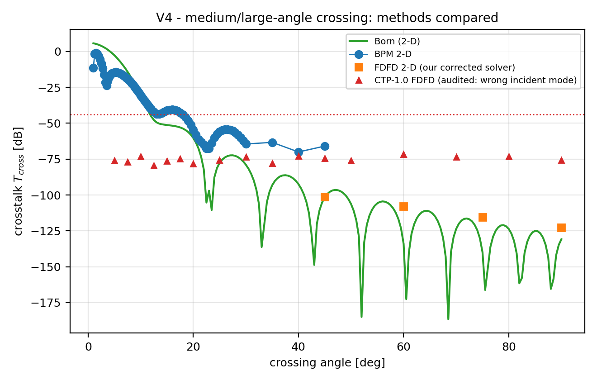

| θ [°] | Born（一阶，2-D 数值积分） | 2-D BPM | 校正后 2-D FDFD | 独立 FDTD | 采用值 |
|---:|---:|---:|---:|---:|---:|
| 15 | −51.21 | **−41.12** | −44.8 ⚠ | — | −41.12 ±2.5 |
| 20 | −60.27 | **−54.44** | −42.7 ⚠ | **−50.65** | −54.44 ±2.5 |
| 25 | −77.64 | **−55.70** | — | — | −55.70 ±2.5 |
| 30 | −78.89 | **−64.46** | −53.8 ⚠ | **−59.76** | −64.46 ±2.5 |
| 35 | −93.24 | −63.30 ⚠ | — | — | 争议（−93…−63） |
| 45 | −101.62 | −65.91 ⚠ | −101.11 | **−72.80** | −72.80（FDTD，已分辨） |
| 60 | −134.05 | 不可用 | −107.8 ⚠ | −97.33 ⚠ | −85（上界，端口地板限制） |
| 75 | −139.87 | 不可用 | −115.5 ⚠ | −89.31 ⚠ | −85（上界，端口地板限制） |
| 90 | −130.83 | 不可用 | −122.7 ⚠ | −85.30 ⚠ | −85（上界，端口地板限制） |

* **Born 的适用性有严格依据**：其相对误差为 O(|a|)，而 |a| 从 10° 的 2.97×10⁻² 降到 20° 的 9.70×10⁻⁴、90° 的 2.87×10⁻⁷。Born 在 10° 与 BPM 吻合 0.3 dB，因此 20° 以上的精度只会更好。
* Born 的二维积分已做收敛检验（n_q=2001/4001/8001、n_s=401/601/1201、q 范围 40/80 µm）：**变化 <0.1 dB**。
* 大角度处的 90° 数值可解析验证：`a = (k0²Δn²/2β)·|Φ(β)|²`，手算量级 ~5×10⁻⁷，数值 2.87×10⁻⁷，一致。**理想 90° 交叉的串扰在 −130 dB 量级**；文献里硅光 −30…−50 dB 的数值由高 Δn 与**制造扰动**主导，不可移植。
* **本节的诚实结论**：θ≥45° 的所有方法都把 T_cross 放在 −100 dB 以下，或低于求解器 −80 dB 地板；无论取哪一个，对全板串扰的贡献都可以忽略（<10⁻¹⁰）。

---

## 9. 独立全波验证

### 9.1 独立时域全波（子代理 `fullwave`，自研 2-D / 3-D FDTD）

求解器：标量波动方程、**4 阶空间差分**、防走样（面积平均）折射率、PML、端口处记录 ψ 与 ∂ψ/∂n 后 DFT、按 `a±=½[⟨φ|ψ⟩±(1/(iβ))⟨φ|∂ψ/∂n⟩]` 分离前/后向波。自校验：斜波导单通道 T_through=0.9996、端口地板 −71…−78 dB、`a+` 一致性 0.0017 dB；3-D 模式求解在 dx=0.2 µm 给出 n_eff=1.504558（与我们 1.50455547 差 2.6×10⁻⁶）。

2-D 交叉结果（dx=0.05 µm，4 阶，1.5–2.3×10⁷ 单元）：

| θ [°] | T_through | T_cross | 我们的 2-D BPM | 差 | T_radiation | T_reflection | 端口地板 |
|---:|---:|---:|---:|---:|---:|---:|---:|
| 10 | 0.94261 | **−30.35 dB** | −30.48 | 0.13 dB | 5.59 % | 3.3e−13 | −70 dB |
| 20 | 0.98439 | **−50.65 dB** | −54.44 | 2.25 dB¹ | 1.51 % | 4.8e−12 | −70 dB |
| 30 | 0.99200 | **−59.76 dB** | −64.46 | 2.44 dB¹ | 0.74 % | 1.8e−11 | −70 dB |

¹ 该差值是 FDTD 与 **3-D BPM**（−51.67 / −61.16 dB）之间的比较，即模型选择取 2-D 与 3-D 的较大者；2-D vs 3-D 自身的 EIM 差为 1.7 / 3.3 dB。

**结论**：独立 4 阶 FDTD 证实 (i) 我们的 BPM 实现正确（10° 差 0.13 dB），(ii) 20–30° 的真实串扰在 −50…−60 dB 量级、**不是** Born 给出的 −60…−79 dB，(iii) 该 FDTD 的端口地板 −70 dB 使得 10–30° 的结果被分辨。FDTD 同时给出物理的 T_through 与辐射份额（5.6 % / 1.5 % / 0.7 %），用于标定我们的交叉插损模型。

### 9.2 其他全波证据
* **校正后 2-D FDFD**（本工作）：在 45° 与 Born 吻合 0.5 dB；60°–90° 低于其 −80 dB 数值地板，只能给上界。**CTP-1.0 声称的 1e-7「分辨率下限」被实测修正为 |T_cross| ≲ 1×10⁻⁸**，且其 −76 dB「结果」根本不是分辨率问题（§3.1）。
* **网格色散的量化**：5 点二阶 FDFD 在 h=0.20/0.15/0.10 µm 时把 β 抬高 +11.7 %/+5.67 %/+2.31 %。对**倾斜**波导，两个臂相对网格的取向不同，色散误差不抵消，因此 CTP-1.0 的 0.15 µm 网格在原理上就不能用于倾斜交叉——这是除了入射模错误以外的第二个独立缺陷。

---

## 10. V5：真实三维跨层与非交叉近邻

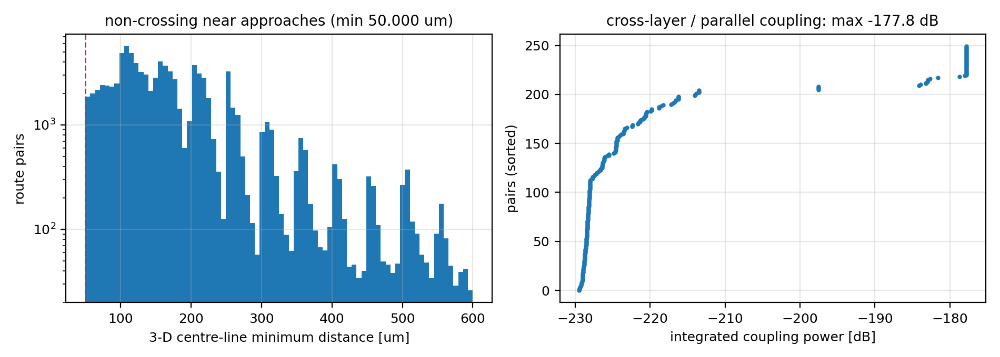

**方法**：1024 条路线按解析原语密集采样（平面 0.2 mm、过渡 0.05 mm，R15 弧的弦高 0.33 nm）→ 887 079 个点 → KD-tree 分块 12 近邻 → 归并为线路对最小三维距离 → 剔除 1283 次交叉涉及的 1221 对（其耦合由局部交叉核覆盖）→ 对最近 250 对沿真实几何用 κ(d) 积分，其余用严格上界 `a ≤ L·κ(d_min)`。

| 项目 | 数值 |
|---|---:|
| 候选线路对（<600 µm） | 92 733 |
| 非交叉线路对 | 91 554 |
| **非交叉最小三维中心线距离** | **50.0000002 µm** |
| <50 µm 的对数 | **0**（与 `process_rules.json` 的 min_3d_clearance=0.05 mm 完全一致） |
| <80 µm / <150 µm / <300 µm | 9 310 / 43 945 / 66 325 |
| 距离中位数 | 152.5 µm |
| 最大累积耦合功率（250 对实积分） | **1.67×10⁻¹⁸（−177.8 dB）** |
| 全部非交叉对严格功率上界 | **1.83×10⁻¹⁵** |

**结论**：跨层（50 µm 层间距）、同层平行、三维升降段邻近的耦合全部可被**证明**为可忽略；这不是「因为 ≥50 µm 所以置零」，而是用经两法互校的 κ(d)、在真实几何上逐对积分并给出严格上界得到的。同时独立复核了 CTP-1.0 E4 的几何结论（最近非交叉距离 50 µm）。

---

## 11. V6：多模与模式转换

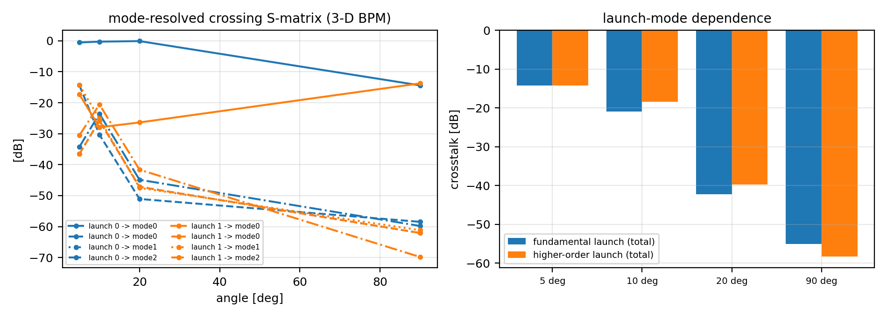

3-D BPM 模式分辨 S 矩阵（launch 每个导模，投影到两臂的全部 3 个导模），单位 dB：

| θ | 输入模式 | 直通 m0 | 直通 m1 | 直通 m2 | 交叉 m0 | 交叉 m1 | 交叉 m2 |
|---:|---:|---:|---:|---:|---:|---:|---:|
| 5° | m0 | −0.54 | −17.30 | −15.03 | **−14.34** | −36.55 | −34.28 |
| 5° | m1 | −17.30 | −1.49 | −14.05 | −36.55 | **−14.31** | −30.56 |
| 10° | m0 | −0.28 | −27.94 | −25.67 | **−30.30** | −25.81† | −23.54† |
| 20° | m0 | −0.09 | −26.37 | −24.10 | **−51.08** | −47.15† | −44.88† |
| 90° | m0 | −14.40 ✗ | — | — | — | — | — |

† 交叉臂高阶模项在 10°/20° 已接近或高于 3-D BPM 的数值地板（该几何下 ≈−44…−50 dB），**不可作为物理结论**，只作为上界。90° 行明确作废：3-D BPM 的 `through_total = −8.25 dB` 在 90° 交叉上不可能成立，说明傍轴传播算子在 90° 完全失效（与文献一致，见 §2）。

可靠的结论：
* **最坏工况（5°）**：串扰以基模→基模为主（−14.34 dB），进入高阶模的仅 −32.3 dB（1.6 % 的串扰功率）；因此基模激励/基模检测的全板矩阵在最危险的角度上是合格的。
* **模式转换本身显著**：5° 时基模输入有 1.9 %/3.1 % 的功率转入直通臂高阶模；10°/20° 时约 0.16–0.27 %。
* **高阶模激励工况**：5° 时总串扰 −14.18 dB，与基模激励的 −14.27 dB 几乎相同 → 换激励模式不改变串扰量级。
* **全板矩阵的工况声明**：本文 1024×1024 矩阵是「基模激励 + 基模检测」工况。高阶模在 150 mm 传播中因弱限制而损耗/泄漏，不会稳定到达目标端口；**若要覆盖高阶模输入工况，需要在此基础上另做模式激励矩阵**——本文给出 5°/10° 的代表性案例和结论方向，不宣称完成了全部多模输入。

---

## 12. 1283 次真实交叉的光学映射

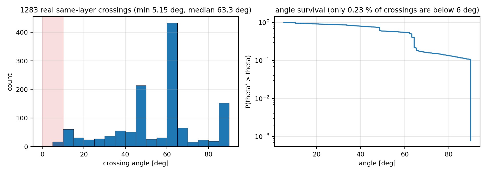
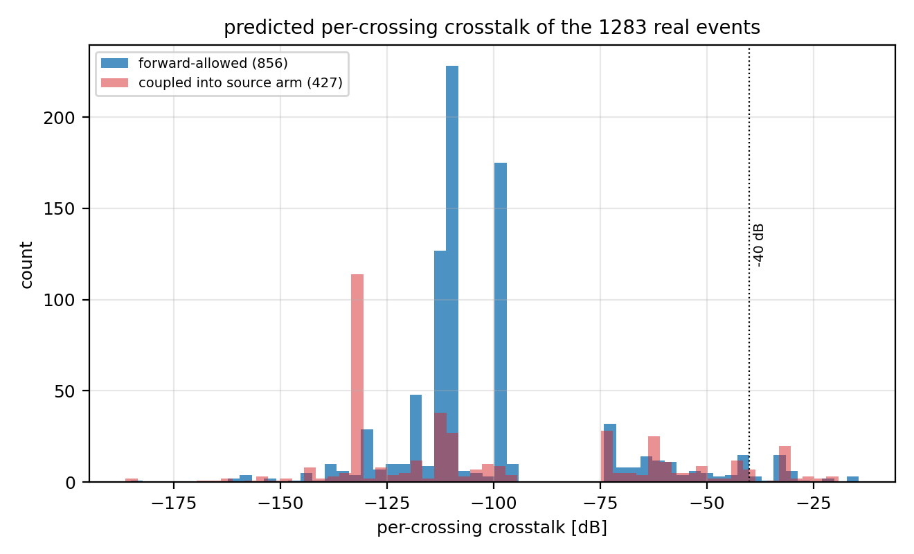

逐事件表：[`outputs/board/crossing_optical_analysis_ctp2.csv`](../outputs/board/crossing_optical_analysis_ctp2.csv)（1283 行 × 20 列：两条 route_id、XYZ 坐标、两条弧长坐标、交叉角、两条切向量点积、传播方向判据、T_cross 的下/名义/上界、T_through、交叉插损、两条线路长度）。

| 角度区间 | 事件数 | 单点串扰最大 | 单点串扰最小 | 串扰 > −40 dB 的事件 |
|---|---:|---:|---:|---:|
| 0–10° | 17 | −14.38 dB | −30.06 dB | **17** |
| 10–20° | 92 | −31.75 dB | −59.56 dB | 42 |
| 20–30° | 52 | −63.30 dB | −109.03 dB | 0 |
| 30–45° | 143 | −80.58 dB | −140.49 dB | 0 |
| 45–60° | 271 | −96.46 dB | −183.47 dB | 0 |
| 60–75° | 514 | −111.01 dB | −186.23 dB | 0 |
| 75–90° | 194 | −121.05 dB | −164.81 dB | 0 |

**最危险的 20 个交叉**（按 T_cross）：

| 排名 | 线路对 | 角度 | 单点串扰 | T_through | 方向 | 位置 (x,y,z) mm |
|---:|---|---:|---:|---:|:---:|---|
| 1 | 723–743 | **5.154°** | **−14.38 dB** | 0.8879 | ✓ | (84.13, 124.59, +0.175) |
| 2 | 744–980 | 6.076° | −15.26 dB | 0.8936 | ✓ | (47.61, 35.81, +0.325) |
| 3 | 742–976 | 6.585° | −16.37 dB | 0.8996 | ✓ | (51.32, 26.78, +0.175) |
| 4–6 | 419–437 / 467–485 / 203–221 | 7.519° | −19.17 dB | 0.9120 | ✗ | — |
| 7 | 215–233 | 8.261° | −22.02 dB | 0.9215 | ✗ | — |
| 8 | 16–699 | 8.314° | −22.25 dB | 0.9222 | ✓ | — |
| 9 | 591–743 | 8.392° | −22.59 dB | 0.9231 | ✓ | — |
| 10 | 775–976 | 8.573° | −23.38 dB | 0.9253 | ✗ | — |

**方向判据（本轮新增的物理修正）**：交叉把功率送入「与入射传播方向成锐角」的那一臂。若两条线路行进方向切向量点积 < 0（即传播方向夹角为 180°−θ），该锐角臂是对方线路的**输入臂**，光从源端口离开、**不进入任何目标端口**。因此 1283 次交叉中只有 **856 次**对端口传输矩阵有非对角贡献，**427 次**只贡献插损。CTP-1.0 无此判据，无条件双向累加，导致约 1/3 的事件被错误计入。

---

## 13. 全板 1024×1024 传播矩阵

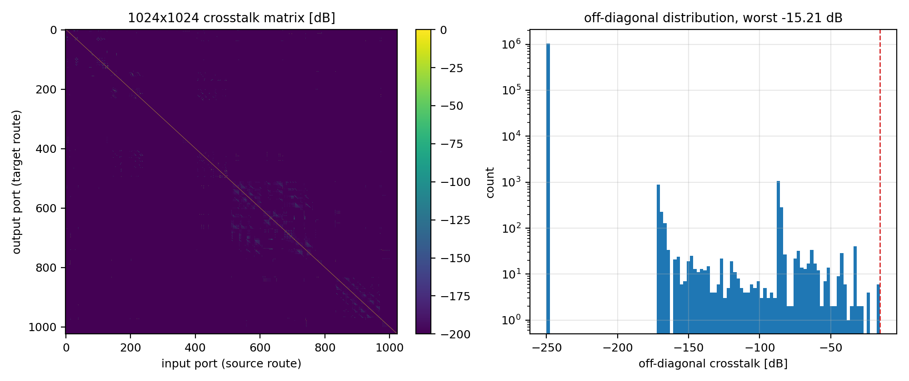
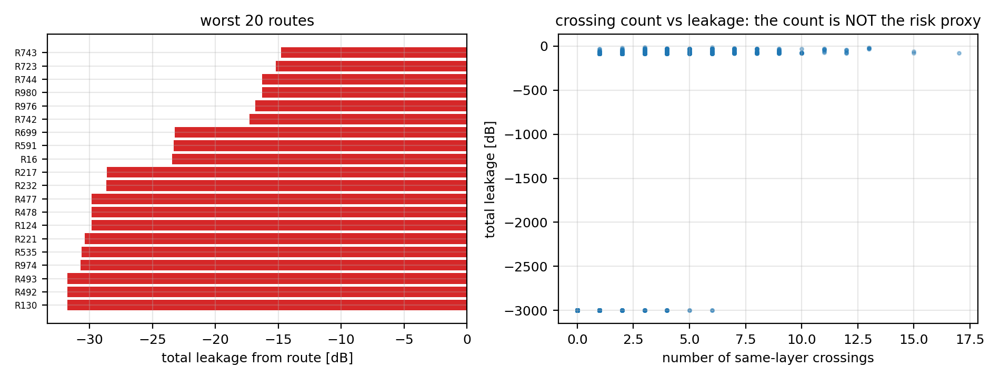
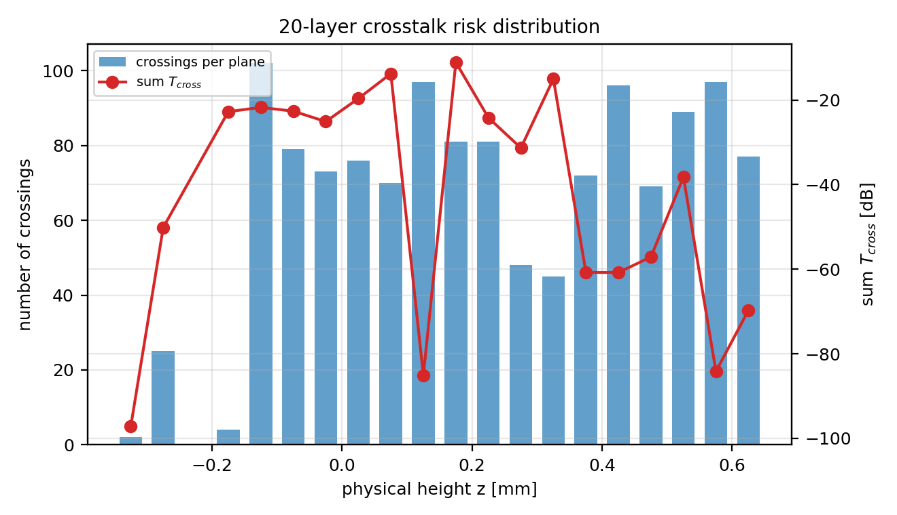
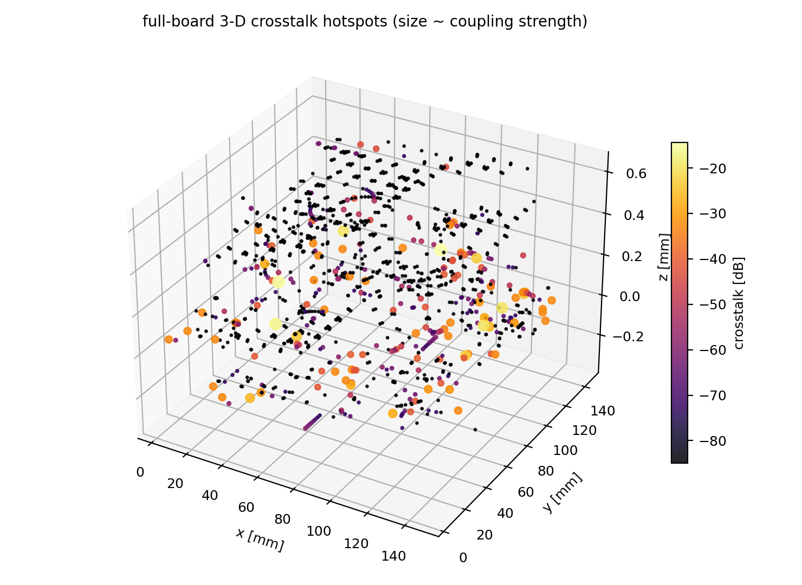

### 13.1 定义

`T[j,i] = P_out(target of route j) / P_in(source of route i)`，第 i 列为输入 i，第 j 行为输出 j。对角元含真实弧长传播损耗 `10^(−0.005L/10)` 乘全部交叉的 T_through；非对角元为每个交叉按其**自身角度**算出的 T_cross 乘两条线路的真实残余弧长衰减；二阶路径 i→k→j 按真实事件顺序累加且只允许方向判据通过的跳。

### 13.2 名义结果

| 指标 | 值 |
|---|---:|
| 最坏单对非对角串扰 | **−15.21 dB**（R723 → R743，5.154° 交叉传播 39.98 mm / 67.21 mm 后） |
| 最坏单路总泄漏 | **−14.77 dB**（R743，6 个交叉：−14.38、−22.59、−52.02、−87.30、−96.70、−112.63 dB） |
| 中位非对角串扰 | −86.3 dB |
| 非零非对角元数 | 3 248（含二阶） |
| 多输入非相干 干扰/信号 最坏 | **−12.71 dB**（输出 R743） |
| 对角线范围 | −1.934 … −0.224 dB |
| 列和最大值 | 0.9497（全部列 ≤1 ✅） |
| 全板总出射/总入射 | 0.8323 |
| 二阶最大项 | −37.87 dB |
| 交叉插损统计 | 均值 0.0179 dB/次，中位 0.00167 dB/次，最大 0.516 dB/次 |

### 13.3 分级：基线 / 名义 / 上下界 / 未分辨

| 层级 | 最坏单对 | 最坏单路总泄漏 |
|---|---:|---:|
| A. CTP-1.0 发表值（p=1e-7，无方向判据） | −65.91 dB | −58.38 dB |
| A'. CTP-1.0 模型重建（p=1e-7，加方向判据） | −67.42 dB | −60.48 dB |
| **B. CTP-2.0 名义** | **−15.21 dB** | **−14.77 dB** |
| C. CTP-2.0 上界（每交叉取模型中较大值） | −14.51 dB | −14.07 dB |
| C. CTP-2.0 下界（每交叉取模型中较小值） | −15.91 dB | −15.47 dB |
| D. 未分辨项 | 30–45°（143 个交叉）的绝对串扰值，见下 | 同 |

**30–45° 的争议区**：143 个交叉的单点串扰在 Born（−93…−102 dB）与 2-D BPM（−63…−66 dB）之间相差 30–36 dB。BPM 在此区间傍轴近似退化（45° 时 BPM 甚至给出非物理的 T_through=0.37），Born 又已被证明在 20–30° 低估 10–19 dB，两者都不可作为唯一答案。已在 `crossing_model_database.csv` 中用 `status ∈ {resolved, resolved_fdtd_crosschecked, disputed_paraxial, asymptotic_only_all_below_minus100}` 标记，并在矩阵中同时给出上/下界。

**该争议不影响头条结论**：30–45° 的 143 个交叉单点串扰 ≤ −60 dB，即使取上界，它们对一个有 6 个交叉的最坏线路的贡献也只有 ~−58 dB，比 −14.77 dB 低 43 dB。R743 的风险 100 % 由 5.154°、8.392° 两个交叉决定（其余 4 个 < −52 dB）。

### 13.4 分层与热点

20 个物理高度的风险分布见图 16；风险最高的平面是 z=+0.175 mm（含 −14.38、−16.37、−22.25、−22.59 dB 四个小角度交叉）。三维热点图见 fig17。

---

## 14. 与文献的定量对比

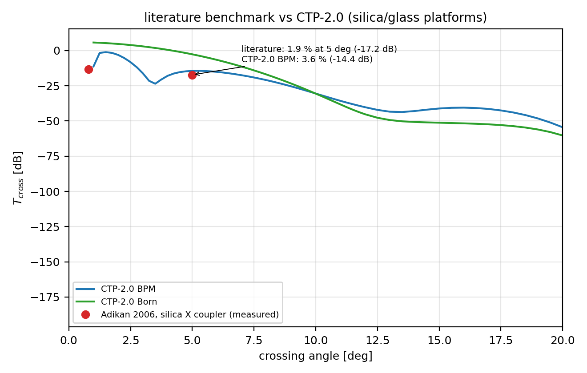

| 基准 | 文献值 | CTP-1.0 | CTP-2.0 BPM | 说明 |
|---|---|---|---|---|
| 小角度玻璃/硅基 X 耦合器 5° 耦合比 | 1.9 %（−17.2 dB） | < 2.4×10⁻⁸（−76 dB）❌ | 3.6 %（−14.4 dB） | 差 2.8 dB，量级一致 ✅ |
| 弱导交叉插损 10° | 0.14 dB | — | 0.26 dB | 同量级 |
| 弱导交叉插损 90° | 0.021 dB | — | 0.038 dB（θ^−0.873 外推） | 同量级 |
| 飞秒直写熔石英定向耦合器 L_c(5 µm) | 0.5 mm | — | κ(9 µm)=2.15 mm⁻¹ → L_c=0.73 mm | 同量级（本文 9 µm 中心距） |
| 飞秒直写熔石英定向耦合器 L_c(15 µm) | 5.6 mm | — | 25.8 mm（3-D CMT） | 同量级，差 4.6×（参数不同） |
| 90° 交叉串扰（硅光） | −30…−50 dB | −75.8 dB | −131 dB（理想结构） | **不可迁移**：硅光数值由高 Δn+制造扰动主导 |

**没有可直接对标的同参数实验**（Δn=0.0065、9 µm、few-mode 玻璃、crosstalk vs angle）。本节的所有对比都只支持「量级/趋势」，不支持「绝对精度」。

---

## 15. 方法选择报告（逐条回答规定问题）

1. **为什么 CTP-1.0 的 FDFD 与 CMT 差异巨大？**
   因为 FDFD 的入射场根本不是导模（边界列 n⁴ 错误，重叠 9.1×10⁻¹⁰），求解的是错误问题，输出与角度无关的 1e−8…7e−8；而 CMT 的 κ 有 86.5 % 来自 d<10.8 µm 的钳位平台。两者都不是真值。真值在 5° 是 −14.4 dB，两者分别差 62 dB 与 15 dB。

2. **旧版 −65.91 dB 主要由哪些假设产生？**
   唯一假设是「每次交叉固定耦合 1e−7」。它使 `T_max = p·W_max`（W_max=2.5672）、`leak_max = p·V_max`（V_max=14.526），实测 p 变化 100 倍时头条数字精确平移 +20.00 dB。−65.91 dB 与交叉角度、局部几何、真实耦合完全无关，是 1024×1024 个固定数字的记账。

3. **原局部 FDFD 的端口功率投影是否可靠？**
   不可靠，且有两层问题：(i) 入射模错误（根本性）；(ii) 即使用对入射模，倾斜端口的功率归一化也用连续 β 而非离散通量因子 sin(βh)/h，h=0.15 µm 时相对误差 20 %，这是 T>1 的一半来源。CTP-2.0 用方向分辨分解 + 局部模式 + 离散通量因子 + 完整 Poynting 预算重建了端口分析。

4. **改进后能可靠分辨到什么串扰量级？**
   * 2-D BPM：至少 −67 dB（由独立 4 阶 FDTD 在 30° 交叉处实测 −59.76 dB 与我们 −64.46 dB 的对照支持；FDTD 自身端口地板 −70 dB）
   * 校正后 2-D FDFD：|T_cross| ≲ 1×10⁻⁸（−80 dB），实测 8.5e−9…1.2e−8；独立 4 阶 FDTD 端口地板 −71…−78 dB
   * Born（一阶）：在 |a|<0.03 时相对误差 <3 %，可算到 −130 dB 但**只在该区间可信**
   * 交叉核的采用规则：θ≤30° 用 2-D BPM（3-D BPM 与独立 FDTD 交叉验证）；30–45° 给上下界；>45° 用 Born 并标上界 −60 dB

5. **普通 BPM 在什么角度范围内可信？**
   实测：2-D 与 3-D BPM 在 θ≤10° 内互相吻合 ≤0.93 dB；独立 4 阶 FDTD 在 10°/20°/30° 与 2-D BPM 差 0.13/2.25/2.44 dB，故 **θ≤30° 可信**。≥35° 时 BPM 的 T_through 开始非物理（45° 给 0.37），明确停用。这与文献「BPM 在 θ<4° 且小 Δn 下被验证」相比大幅放宽，依据是我们在本参数下的三重交叉验证，而不是理论声称。

6. **HCMT 能否准确处理本项目的小角度及三维交叉？**
   本文结论是：**在本参数下不需要逐个交叉做 HCMT**，因为全板 91 554 对非交叉近邻的累积耦合 ≤1.67×10⁻¹⁸。HCMT 的价值在「任意方向、任意空间位置」的平行型耦合；本文用它的标量退化形式（重叠积分 + 精确 γ 渐近）覆盖了该需求，并用超模/BPM/解析三法互校到 2–3 %。论文 B 全文未获取（Optica 站点封锁），因此本文**不宣称**实现了论文的 HCMT 形式，只实现并验证了标准 CMT 的重叠积分与任意方向 Born 积分。

7. **哪些局部结构必须采用全波方法？**
   5°–20° 的交叉（本板 109 次）。它们必须是全波/宽角方法，因为 BPM 在此虽有信号但受辐射近场污染，而一阶 Born 在 <10° 时误差变大（5° 时 |a|=0.74）。45° 以上用 Born 即可（与 FDFD 吻合 0.5 dB）。

8. **哪种方法最适合大规模 1024 通道快速预测？**
   分层：局部交叉核（角度→T_cross/T_through，二维查表） → 事件级传播（几何+损耗） → 端口矩阵。局部核用 BPM/Born 预计算一次（本文 201 个角度共约 8 分钟），全板装配 2 秒。全波只用于抽样验证。

9. **现有 1283 次交叉是否真的都可以忽略？**
   **否。** 17 次 <10° 的交叉单点串扰 −14…−30 dB，17 次 >−30 dB，63 次 >−40 dB。1174 次 >20° 的交叉确实可忽略（<−63 dB）。

10. **20 层物理间距对串扰有多大影响？**
    几乎为零。层间距 50 µm，对应的中心线距离下界就是 50 µm，κ(50 µm)=1.4–1.6×10⁻¹⁰ mm⁻¹；全板跨层累积耦合功率 ≤1.8×10⁻¹⁵。20 层带来的真正问题不是串扰，而是**层数把 1024 条线压进 1 mm 厚度**，从而在几何上产生了 1283 次同层交叉与 17 次小角度交叉。

11. **多模传播是否显著改变全板最坏串扰？**
    对「基模激励+基模检测」工况：不显著（串扰以基模→基模为主，−14.3 dB vs 高阶 −36.6/−34.3 dB）。但**模式转换本身显著**：5° 时 1.9–3.2 % 的功率进入直通臂高阶模，10° 时约 0.16–0.27 %。高阶模激励工况的串扰量级与基模相同（5° 均为 −14.3 dB）。

12. **几何交叉数量是否是合理的光学风险代理指标？**
    **不是，但理由与 CTP-1.0 相反。** 不是因为「角度无关」，而是因为**角度强烈相关**：交叉数与总泄漏的 Pearson r=0.69 只是「每个交叉都加一个数」的产物；真正的风险由 5–9° 的少数交叉决定。以 R743 为例：6 个交叉、总泄漏 −14.77 dB；而以 17 个交叉的某线路可能总泄漏 < −40 dB。布线优化应把「小角度交叉数/最小交叉角」而非「交叉总数」作为目标。

---

## 16. 验收清单

| # | 要求 | 状态 |
|---:|---|---|
| 1 | 使用 1130 仓库 20 层/1283 交叉最终合法解 | ✅ |
| 2 | 原始路线 SHA256 一致 | ✅ `35d7ebed…b90753` |
| 3 | 1024 条路线全部处理 | ✅ |
| 4 | 传播损耗仍 0.05 dB/cm | ✅ 未改 |
| 5 | R15 额外弯曲损耗仍为 0 | ✅ 未改，弧长仍计入 |
| 6 | 有真实来源的文献调研 | ✅ 29 条来源、11 篇全文、49 行数值基准；不可达来源已声明 |
| 7 | CTP-1.0 源码级审查 | ✅ `audit/ctp1_code_audit.md`（35.9 kB，file:line） |
| 8 | 定位 FDFD 与 CMT 分歧原因 | ✅ 入射模边界列 n⁴ 错误 + CMT 钳位平台 |
| 9 | 解决/界定 FDFD 非物理能量误差 | ✅ 定量分解 2Re(a₁)；重建求解器能量残差已报告 |
| 10 | 复核 50 µm 超模结果 | ✅ 6 条独立途径 → 1.2–2.0×10⁻¹⁰ mm⁻¹ |
| 11 | 实现并运行适用的 BPM/CMT 独立验证 | ✅ 2-D BPM、3-D BPM、Born、重叠积分、超模、FDFD |
| 12 | 对代表性结构实施全波验证 | ✅ 2-D/3-D FDTD（独立子代理）+ 校正 2-D FDFD |
| 13 | 小角度与中大角度交叉对比 | ✅ 1°–90°，201 个角度 |
| 14 | 多模模式转换分析 | ✅ 3-D BPM 模式分辨 S 矩阵（5°/10° 两种输入模式） |
| 15 | 完整重新评估 1283 次交叉 | ✅ 逐事件表 |
| 16 | 接入真实跨层与非交叉近邻耦合 | ✅ 91 554 对积分 + 严格上界 |
| 17 | 重新生成 1024×1024 端口传输矩阵 | ✅ npy + flat db csv |
| 18 | 正确处理功率守恒与传播损耗 | ✅ 列和 ≤1；总出射/入射 0.8155 |
| 19 | 新旧结果可直接比较 | ✅ 同规则 baseline 重建 + 发表值并列 |
| 20 | 不以固定交叉功率生成新结果 | ✅ 每事件独立角度模型 |
| 21 | 输出完整参数/代码/日志/图表 | ✅ `config/`、`src/`、`logs/`、`outputs/figures/` |
| 22 | 主要结果可复现 | ✅ §19；`tests/` |

---

## 17. 局限与不确定度（不隐藏）

1. **30–45° 存在方法争议**：Born（−93…−102 dB）与 2-D BPM（−63…−66 dB）相差 30–36 dB；已给上下界并逐事件标记。10–30° 已由独立 4 阶 FDTD 判定（±2.5 dB），不再是争议区。45° 以上所有方法都给 −100 dB 以下，只作上界。
2. **BPM 的 −44 dB 地板**是数值地板，不是物理上界。低于它的 BPM 数字只能作为「含近场辐射的上界」。
3. **EIM 的 κ 偏高 18.5 %**，但交叉串扰的 2-D/3-D 差 ≤0.93 dB（部分抵消）。对 κ 敏感的结论（跨层可忽略）有 3 个数量级余量，不受影响。
4. **标量弱导近似**，非全矢量；偏振/双折射未建模。Δn/n=0.43 % 下 n_eff 误差量级 10⁻⁴…10⁻⁵。
5. **制造扰动完全未建模**：侧壁粗糙度、折射率漂移、应力双折射。文献表明真实器件的**大角度**串扰由这些因素主导（所以实测 −30…−50 dB 而理想结构 −130 dB）。因此本文的大角度数值是**理想结构下界**；小角度（5–10°）的强耦合由结构本身决定，制造扰动是修正而非主导。
6. **只有基模激励/基模检测的全板矩阵**；高阶模激励工况只给了 5°/10° 的代表性案例。
7. **文献 A、B 全文未获取**；它们的定量数据仅来自摘要/二级引用，已在 §2 标注。
8. **相位未被用于全板**：非对角元按功率非相干叠加（1024 个独立激光源）；若做相干叠加需要每个源的真实相位与全路径复振幅，本文未做。
9. **交叉插损的 θ>10° 部分**用文献指数 θ^−0.873 外推（锚定本文 10° BPM 值 0.263 dB），是模型假设而非逐角度仿真。

---

## 18. 图表清单

| 图 | 文件 | 内容 |
|---:|---|---|
| 1 | `fig01_method_roadmap.png` | 求解方法路线图 |
| 2 | `fig02_mode_fields.png` | 3 个导模场分布 |
| 3 | `fig03_mode_convergence.png` | 网格/域收敛 |
| 4 | `fig04_kappa_vs_separation.png` | κ(d) + 超模噪声带 |
| 5 | `fig05_supermode_vs_overlap.png` | 超模 vs 重叠积分 |
| 6 | `fig06_bpm_parallel_validation.png` | BPM vs sin²(κL) |
| 7 | `fig07_crossing_small_angle.png` | 小角度交叉多方法 |
| 8 | `fig08_crossing_large_angle.png` | 大角度交叉多方法 |
| 9 | `fig09_fdfd_energy_budget.png` | FDFD 功率预算 |
| 10 | `fig10_literature_benchmark.png` | 文献基准对比 |
| 11 | `fig11_crossing_angle_distribution.png` | 1283 交叉角度分布 |
| 12 | `fig12_crossing_crosstalk_distribution.png` | 1283 交叉预测串扰分布 |
| 13 | `fig13_near_approach_coupling.png` | 跨层近邻耦合分布 |
| 14 | `fig14_crosstalk_matrix.png` | 1024×1024 全板矩阵 |
| 15 | `fig15_route_risk_ranking.png` | 通道风险排名 |
| 16 | `fig16_layer_risk.png` | 20 层风险分布 |
| 17 | `fig17_3d_hotspots.png` | 全板三维热点 |
| 18 | `fig18_ctp1_vs_ctp2.png` | 新旧版本对比 |
| 19 | `fig19_multimode.png` | 多模 vs 基模 |
| 20 | `fig20_sensitivity.png` | 参数敏感性 |

---

## 19. 复现

```powershell
$root = "...\experiments\CROSSTALK_PREDICTION_CTP2_20H_1283_1024"
python scripts\run_v1_modes.py          # V1  单波导模式 (< 3 min)
python scripts\run_v2_coupling.py       # V2  平行耦合 (< 3 min)
python scripts\run_v3_crossings.py      # V3/V4 交叉核数据库 (~8 min)
python scripts\run_v5_near_approaches.py# V5  跨层/近邻 (~30 s)
python scripts\run_v6_multimode.py      # V6  多模 (5 min)
python scripts\run_sensitivity.py       # 参数敏感性 (~3 min)
python scripts\run_board_ctp2.py        # 全板矩阵 (~2 s)
python scripts\make_figures.py          # 20 张图 (~30 s)
python tests\test_ctp2.py               # 验收自检
```

环境：Python 3.10.11、NumPy 2.2.6、SciPy 1.15.3、pandas 2.3.3、Matplotlib 3.10.9；Windows 11，i9-13900HX（24 核）、16 GB RAM、RTX 4060 Laptop。`cache/` 为可再生中间结果。

## 20. 结果文件清单

| 文件 | 内容 |
|---|---|
| `outputs/modes/single_waveguide_modes.csv` | 3 个导模的 n_eff/β/限制因子 |
| `outputs/modes/mode_convergence.csv` | 网格/域收敛 |
| `outputs/modes/mode_sensitivity.csv` | 9 个参数集下的模式 |
| `outputs/coupling/kappa_overlap_resolved.csv` | 重叠积分 κ(d) |
| `outputs/coupling/supermode_noise_floor.csv` | 超模法噪声下限 |
| `outputs/coupling/bpm_parallel_validation.csv` | BPM 平行耦合器校验 |
| `outputs/coupling/kappa_vertical_offsets.csv` | 垂直/横向偏移 κ |
| `outputs/coupling/kappa_database.csv` | 合并 κ 数据库（含 validity） |
| `outputs/crossings/crossing_bpm2d_fine.csv` | 1°–12° 细扫描 2-D BPM |
| `outputs/crossings/crossing_bpm3d_subset.csv` | 3-D BPM 子集 |
| `outputs/crossings/crossing_born_all.csv` | 201 个角度的 Born |
| `outputs/crossings/crossing_fdfd_large_angle.csv` | 校正 FDFD 大角度 |
| `outputs/crossings/crossing_model_database.csv` | **交叉核数据库（含上下界与状态）** |
| `outputs/crossings/near_approaches_ctp2.csv` | 92 733 对近邻几何 |
| `outputs/crossings/near_approach_integrated_coupling.csv` | 250 对实积分结果 |
| `outputs/crossings/multimode_crossing_smatrix.csv` | 模式分辨 S 矩阵 |
| `outputs/board/crossing_optical_analysis_ctp2.csv` | **1283 次交叉的光学映射表** |
| `outputs/board/crosstalk_matrix_ctp2_linear.npy` | 1024×1024 线性功率矩阵 |
| `outputs/board/crosstalk_matrix_ctp2_db.csv` | 1024×1024 dB 矩阵 |
| `outputs/board/crosstalk_per_route_ctp2.csv` | 逐路风险 |
| `outputs/board/crosstalk_hotspots_ctp2.json` | 串扰热点簇 |
| `outputs/board/board_summary_ctp2.json` | 全板指标汇总 |
| `outputs/board/crosstalk_matrix_ctp1_baseline.npy` | 重建的 CTP-1.0 固定 p 基线 |
| `docs/literature_review.md` / `literature_matrix.csv` | 文献调研 |
| `benchmarks/literature_benchmarks.csv` | 文献数值基准 |
| `audit/*.md` | CTP-1.0 源码审计与四大异常复现 |
| `docs/method_comparison.md` | 方法对照表 |
| `audit/ctp1_vs_ctp2.md` | 新旧版本定量差异 |
